<div align="center">

# 🔐 gcp-azure-ha-vpn-bgp

### Multi-Cloud Private Connectivity · GCP HA VPN ↔ Azure Active-Active VPN Gateway · IPsec/IKEv2 · BGP

[](https://cloud.google.com/network-connectivity/docs/vpn/concepts/overview)
[](https://cloud.google.com/network-connectivity/docs/router)
[](https://learn.microsoft.com/azure/vpn-gateway/vpn-gateway-about-vpngateways)
[](https://learn.microsoft.com/azure/vpn-gateway/bgp-howto)
[](#-theory-the-concepts-you-need)
[](#-step-12--validate)

---

*A real, hands-on build of a **highly available, dynamically routed site-to-site VPN between Google Cloud and Microsoft Azure**: a GCP HA VPN gateway with a Cloud Router on one side, an Azure VPN gateway in active-active mode on the other, two IPsec/IKEv2 tunnels, two BGP sessions over APIPA addresses, and a private-IP ping between VMs in each cloud as the proof. Every step is backed by real console screenshots.*

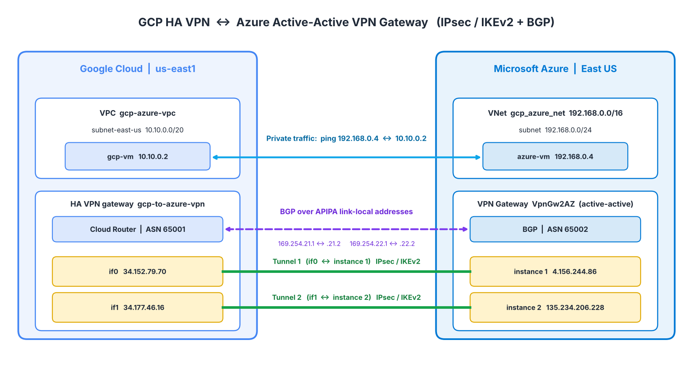

</div>

---

## 📋 Table of Contents

- [Overview](#-overview)
- [Architecture](#-architecture)
- [Theory: The Concepts You Need](#-theory-the-concepts-you-need)
- [Design & Addressing Plan](#-design--addressing-plan)
- [What Was Built](#-what-was-built)
- [Prerequisites](#-prerequisites)
- [Repository Structure](#-repository-structure)
- [Step 1: Azure Resource Group](#-step-1--azure-resource-group)
- [Step 2: Azure VNet & Subnets](#-step-2--azure-vnet--subnets)
- [Step 3: Azure VM](#-step-3--azure-vm)
- [Step 4: GCP VPC & VM](#-step-4--gcp-vpc--vm)
- [Step 5: Baseline Ping (Before VPN)](#-step-5--baseline-ping-before-vpn)
- [Step 6: Azure Public IPs](#-step-6--azure-public-ips)
- [Step 7: GCP HA VPN, Cloud Router & Tunnels](#-step-7--gcp-ha-vpn-cloud-router--tunnels)
- [Step 8: Azure Active-Active VPN Gateway](#-step-8--azure-active-active-vpn-gateway)
- [Step 9: Azure Local Network Gateways](#-step-9--azure-local-network-gateways)
- [Step 10: Azure Connections](#-step-10--azure-connections)
- [Step 11: GCP BGP Sessions](#-step-11--gcp-bgp-sessions)
- [Step 12: Validate](#-step-12--validate)
- [Gotchas Reference Table](#-gotchas-reference-table)
- [Troubleshooting](#-troubleshooting)
- [Cost & Cleanup](#-cost--cleanup)
- [Snapshots](#-snapshots)
- [Resources](#-resources)

---

## 🌐 Overview

A single VPN tunnel is a single point of failure. This guide builds the **highly available** pattern: both clouds expose **two** endpoints, two tunnels connect them pairwise, and **BGP** advertises routes dynamically, so if one tunnel dies the routes are withdrawn and traffic shifts to the other. No static routes anywhere.

### 🔑 Key Facts

| Property | Value |
|---|---|
| ☁️ **Clouds** | Google Cloud (`us-east1`) and Microsoft Azure (East US) |
| 🔐 **VPN type** | Site-to-site IPsec, **IKEv2**, pre-shared key |
| 🔀 **Routing** | Dynamic **BGP**: GCP ASN `65001`, Azure ASN `65002` |
| 🧵 **Tunnels** | 2 (one per GCP HA VPN interface ↔ one per Azure gateway instance) |
| 🔗 **BGP peering** | Link-local **APIPA** pairs `169.254.21.x` and `169.254.22.x` |
| 🖥️ **Test workloads** | `gcp-vm` `10.10.0.2` ↔ `azure-vm` `192.168.0.4` (private IPs only) |
| 🛠️ **Tooling** | Cloud consoles only (no Terraform in this guide) |
| 📸 **Evidence** | 64 real console screenshots, sorted by step in [`docs/snapshots/`](docs/snapshots) |

### ✨ What Makes This Different

| Capability | Description |
|---|---|
| 🔁 **Full lifecycle, not a fragment** | VMs can't ping → public IPs → GCP gateway & tunnels → Azure gateway, LNGs, connections → BGP sessions → live ping confirmed |
| 🧪 **Before/after proof** | A baseline failed ping is captured *before* the VPN exists, so the success afterwards actually means something |
| 🔢 **Every value shown** | IPs, ASNs, APIPA addresses, and names for both clouds in one addressing plan, so you can reproduce it exactly |
| 🧭 **Right order of operations** | Azure public IPs first → GCP side → Azure side → BGP last, which avoids the chicken-and-egg problem of needing each side's IPs |

### ❓ Why HA VPN + BGP?

| Benefit | How It Showed Up Here |
|---|---|
| **99.99% availability design** | Two GCP interfaces, each paired with its own Azure gateway instance |
| **No static routes** | Routes were learned over BGP as soon as the sessions came up |
| **Automatic failover** | A failed tunnel's routes are withdrawn by BGP; traffic continues over the other tunnel |
| **Low cost vs. dedicated links** | Runs over the internet. Good for dev/test, DR links and migrations before moving to Interconnect/ExpressRoute |

---

## 🏛️ Architecture

```
            GCP (us-east1)                                  Azure (East US)
  ┌─────────────────────────────┐                 ┌──────────────────────────────────────┐
  │ VPC: gcp-azure-vpc          │                 │ VNet: gcp_azure_net  192.168.0.0/16  │
  │ 10.10.0.0/20                │                 │  ├─ gcp_azure_east-us 192.168.0.0/24 │
  │  └─ gcp-vm   10.10.0.2      │                 │  │    └─ azure-vm  192.168.0.4       │
  │                             │                 │  └─ GatewaySubnet 192.168.2.0/27     │
  │ HA VPN GW: gcp-to-azure-vpn │                 │                                      │
  │  if0 34.152.79.70 ──────────┼── Tunnel 1 ─────┼── 4.156.244.86     (VNG instance 1)  │
  │  if1 34.177.46.16 ──────────┼── Tunnel 2 ─────┼── 135.234.206.228  (VNG instance 2)  │
  │                             │   IPsec/IKEv2   │ VNG: active-active, VpnGw2AZ         │
  │ Cloud Router  ASN 65001     │◄──── BGP ──────►│ BGP ASN 65002                        │
  │  169.254.21.1 / 169.254.22.1│  (APIPA /30s)   │  169.254.21.2 / 169.254.22.2         │
  └─────────────────────────────┘                 └──────────────────────────────────────┘
```

| Tunnel | GCP interface | Azure gateway IP | GCP BGP IP | Azure BGP IP |
|---|---|---|---|---|
| 🟢 **Tunnel 1** | `34.152.79.70` (if0) | `4.156.244.86` | `169.254.21.1` | `169.254.21.2` |
| 🟢 **Tunnel 2** | `34.177.46.16` (if1) | `135.234.206.228` | `169.254.22.1` | `169.254.22.2` |

### 🔄 Build Order

```
 Azure RG/VNet/VM ──► GCP VPC/VM ──► Baseline ping (fails) ──► Azure public IPs
        │
        ▼
 GCP HA VPN gateway + Cloud Router + 2 tunnels  (BGP "later")
        │
        ▼
 Azure VNG (active-active, BGP, APIPA) ──► 2 Local Network Gateways ──► 2 Connections
        │
        ▼
 GCP BGP sessions (manual APIPA) ──► Tunnels Established ──► Ping succeeds ✅
```

---

## 🧠 Theory: The Concepts You Need

| Concept | What it is | Role in this build |
|---|---|---|
| 🔐 **Site-to-site IPsec VPN** | Encrypted tunnel over the internet between two networks | Needs a public IP per endpoint, an IKE version (**IKEv2**) and a pre-shared key |
| ☁️ **GCP HA VPN** | Regional Cloud VPN gateway with **two interfaces**, each with its own public IP | Two tunnels over two interfaces gives Google's **99.99% SLA**. Supports **BGP only** |
| 🧭 **Cloud Router** | The BGP speaker on the GCP side | Learns Azure prefixes, advertises VPC subnets. ASN `65001` |
| 🔷 **Azure VPN Gateway (active-active)** | Both gateway instances are live, each with its own public IP | Maps one-to-one to the two HA VPN interfaces |
| 📍 **Local Network Gateway (LNG)** | Azure's object that describes the *remote* site (public IP, ASN, BGP peer IP) | **One LNG per GCP interface**, so two LNGs |
| 🔀 **BGP** | Dynamic route exchange between the two sides | No static routes, and failed tunnels are withdrawn automatically |
| 🔗 **APIPA** | Link-local `169.254.x.x` addresses used as BGP peer IPs | Azure accepts only `169.254.21.0`–`169.254.22.255` |
| 🔢 **ASNs** | Private AS numbers; eBGP needs *different* ones on each side | `65001` (GCP) and `65002` (Azure). Avoid Azure-reserved `65515` |

---

## 📐 Design & Addressing Plan

| Item | ☁️ GCP | 🔷 Azure |
|---|---|---|
| Region | `us-east1` | East US |
| Network | VPC `gcp-azure-vpc` (custom mode) | VNet `gcp_azure_net` `192.168.0.0/16` |
| Workload subnet | `subnet-east-us` `10.10.0.0/20` | `gcp_azure_east-us` `192.168.0.0/24` |
| Gateway subnet | not needed | `GatewaySubnet` `192.168.2.0/27` |
| Test VM | `gcp-vm` `10.10.0.2` (e2-medium, `us-east1-d`) | `azure-vm` `192.168.0.4` (Ubuntu 24.04, B1s) |
| VPN gateway | HA VPN `gcp-to-azure-vpn` | VNG `gcp_to_azure_vpn`, `VpnGw2AZ`, Gen2, active-active |
| BGP ASN | `65001` (Cloud Router `gcp-to-azure-vpn-router`) | `65002` |
| IKE / PSK | IKEv2 / `<YOUR_SHARED_KEY>` | IKEv2 / same key |

> ⚠️ **The two private ranges (`10.10.0.0/20` and `192.168.0.0/16`) must not overlap.**
>
> 🔑 **Use your own PSK.** Never reuse a key from screenshots. Generate one with `openssl rand -base64 32`.

---

## 🏗️ What Was Built

| Resource | GCP | Azure |
|---|---|---|
| Network | ✅ VPC `gcp-azure-vpc` + subnet | ✅ Resource group, VNet, subnet, `GatewaySubnet` |
| Test VM | ✅ `gcp-vm` | ✅ `azure-vm` |
| Public IPs for VPN | ✅ 2 (auto-allocated to HA VPN) | ✅ 2 (Standard, regional) |
| VPN gateway | ✅ HA VPN gateway (2 interfaces) | ✅ VNG `VpnGw2AZ`, active-active |
| Routing | ✅ Cloud Router, ASN `65001` | ✅ BGP enabled, ASN `65002`, 2 APIPA IPs |
| Peer object | ✅ Peer VPN gateway (2 interfaces) | ✅ 2 × Local Network Gateway |
| Tunnels | ✅ 2 × IKEv2 tunnels | ✅ 2 × site-to-site connections |
| BGP sessions | ✅ 2 × manual APIPA sessions | ✅ BGP enabled on both connections |
| Validation | ✅ `gcp-vm` → `192.168.0.4`: 0% loss, ~15 ms | ⏳ Reverse ping `azure-vm` → `10.10.0.2` recommended (not captured) |

---

## ✅ Prerequisites

- ☁️ A **GCP project** with billing and the Compute Engine API enabled
- 🔷 An **Azure subscription** (free trial works, but `VpnGw2AZ` is billed hourly, see [Cost & Cleanup](#-cost--cleanup))
- 🛡️ Permission to create networking resources in both clouds
- 🔥 Firewall rules that allow your test traffic:
  - **GCP:** allow ICMP and SSH from `192.168.0.0/16` on `gcp-azure-vpc`
  - **Azure:** the VM's NSG must allow ICMP from `10.10.0.0/20`

---

## 📁 Repository Structure

```
gcp-azure-ha-vpn-bgp/
│
├── docs/
│   └── snapshots/                           # Real console screenshots, grouped by step
│       ├── 00-architecture/                 #   architecture diagram
│       ├── 01-azure-resource-group/         #   4 screenshots
│       ├── 02-azure-vnet/                   #   7 screenshots
│       ├── 03-azure-vm/                     #   4 screenshots
│       ├── 04-gcp-vpc-and-vm/               #   3 screenshots
│       ├── 05-ping-before-vpn/              #   1 screenshot
│       ├── 06-azure-public-ips/             #   4 screenshots
│       ├── 07-gcp-ha-vpn/                   #   9 screenshots
│       ├── 08-azure-vnet-gateway/           #   5 screenshots
│       ├── 09-azure-local-network-gateways/ #  10 screenshots
│       ├── 10-azure-connections/            #  10 screenshots
│       ├── 11-gcp-bgp-sessions/             #   6 screenshots
│       └── 12-validation/                   #   1 screenshot
│
└── README.md                                # This file
```

---

## 🔹 Step 1 · Azure Resource Group

**Resource groups → Create.** One resource group holds everything on the Azure side.

| Field | Value |
|---|---|
| Subscription | your subscription |
| Resource group | `gcp_azure` |
| Region | East US |

<table>
<tr>
<td width="50%">

**Resource groups → Create**
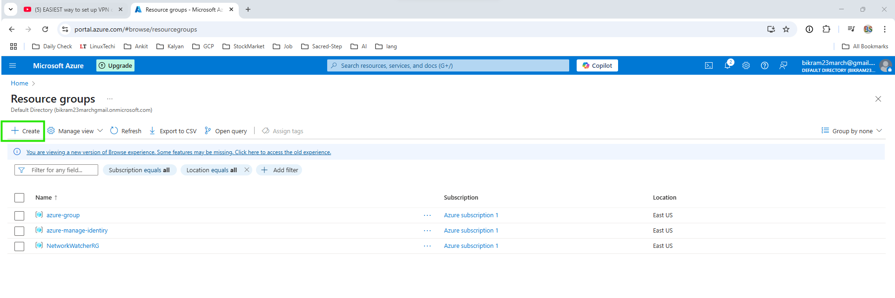

</td>
<td width="50%">

**Basics**


</td>
</tr>
<tr>
<td width="50%">

**Review + create**


</td>
<td width="50%">

**Resource group created**


</td>
</tr>
</table>

---

## 🔹 Step 2 · Azure VNet & Subnets

**Virtual networks → Create**: VNet `gcp_azure_net`, address space `192.168.0.0/16`, workload subnet `gcp_azure_east-us` `192.168.0.0/24`.

<table>
<tr>
<td width="50%">

**All services → Virtual networks**
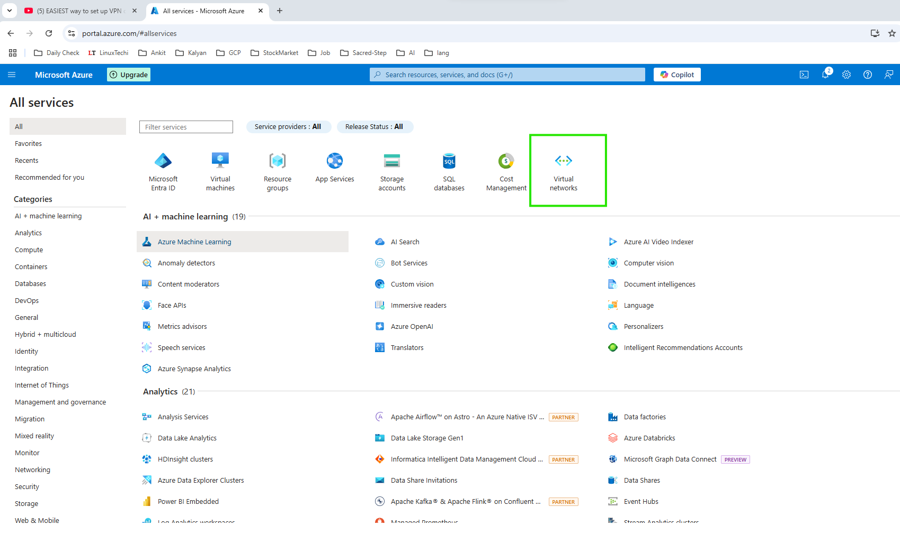

</td>
<td width="50%">

**Basics: resource group `gcp_azure`, name `gcp_azure_net`**


</td>
</tr>
<tr>
<td width="50%">

**IP addresses: edit the default subnet**


</td>
<td width="50%">

**Subnet `gcp_azure_east-us` `192.168.0.0/24`**


</td>
</tr>
</table>


### 🚪 Add the GatewaySubnet

Open the VNet → **Subnets → + Subnet**. Set **Subnet purpose: Virtual Network Gateway** (the name `GatewaySubnet` is fixed), starting address `192.168.2.0`, size `/27`.

> 💡 A `/27` is the minimum Microsoft recommends for the gateway subnet.

<table>
<tr>
<td width="50%">

**Add a subnet: purpose Virtual Network Gateway**
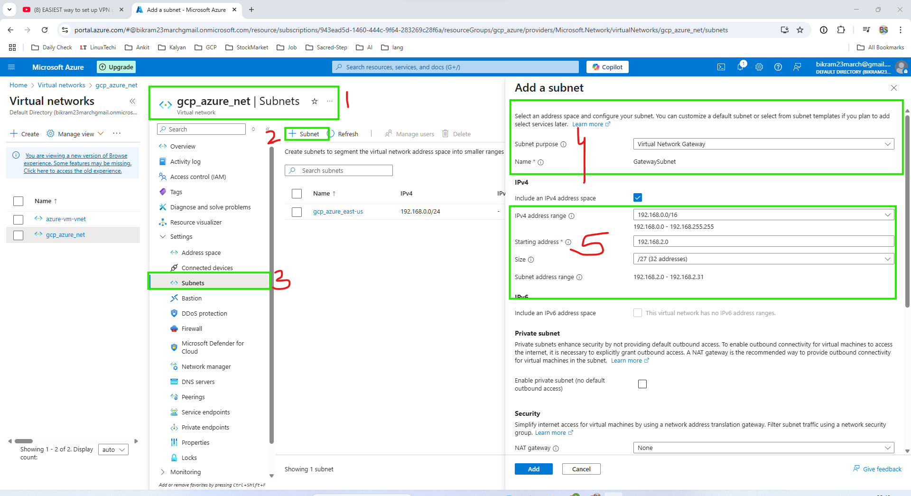

</td>
<td width="50%">

**Both subnets listed**


</td>
</tr>
</table>

---

## 🔹 Step 3 · Azure VM

**Virtual machines → Create → Azure virtual machine.**

| Field | Value |
|---|---|
| Resource group | `gcp_azure` |
| Name | `azure-vm` |
| Region | East US |
| Image | Ubuntu Server 24.04 LTS (x64 Gen2) |
| Networking | VNet `gcp_azure_net`, subnet `gcp_azure_east-us`, new public IP, NSG **Basic**, allow **SSH (22)** |

<table>
<tr>
<td width="50%">

**VM list**


</td>
<td width="50%">

**Basics**


</td>
</tr>
<tr>
<td width="50%">

**Networking**


</td>
<td width="50%">

**Review + create**
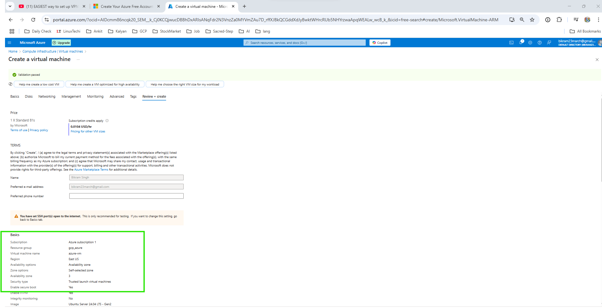

</td>
</tr>
</table>

✅ **Result:** Azure VM private IP **`192.168.0.4`**

---

## 🔹 Step 4 · GCP VPC & VM

1. **VPC network → Create VPC network:** name `gcp-azure-vpc`, subnet mode **Custom**, subnet `subnet-east-us` in `us-east1` with range `10.10.0.0/20`.
2. **Compute Engine:** create `gcp-vm` in `us-east1-d` on that subnet, and add a firewall rule allowing ICMP and SSH.

<table>
<tr>
<td width="33%">

**Create VPC & subnet**
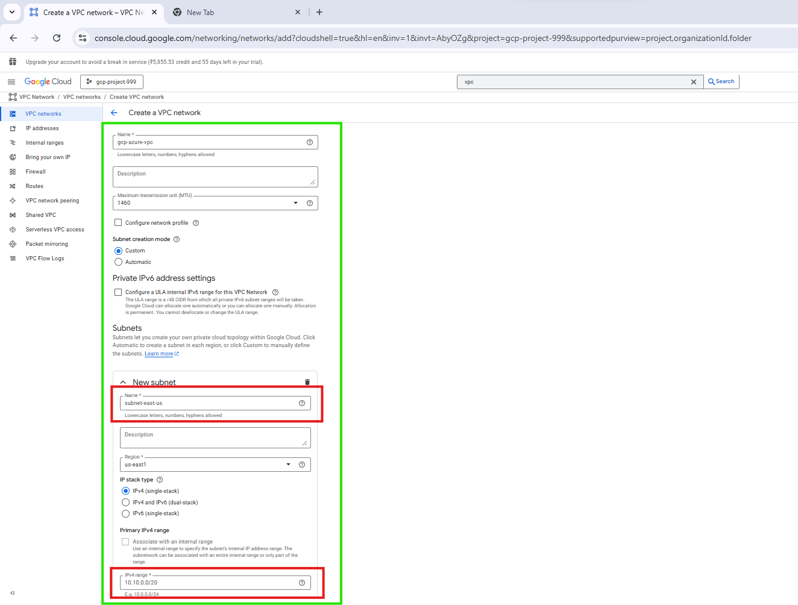

</td>
<td width="33%">

**GCP VM internal IP `10.10.0.2`**
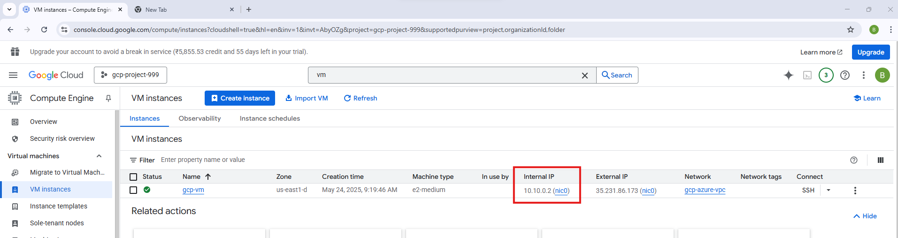

</td>
<td width="33%">

**Azure VM private IP `192.168.0.4`**


</td>
</tr>
</table>

---

## 🔹 Step 5 · Baseline Ping (Before VPN)

Ping each VM from the other using the **private IP**. Both must **fail**: there is no path between the networks yet.

```bash
# on gcp-vm
ping 192.168.0.4

# on azure-vm (SSH or Azure Cloud Shell)
ping 10.10.0.2
```


---

## 🔹 Step 6 · Azure Public IPs

An active-active gateway needs **two** Standard public IPs. Create them first so the addresses are known before configuring GCP.

**Public IP addresses → Create** (twice):

| Name | SKU / Tier | Region | Result |
|---|---|---|---|
| `gcp_azure_vpn_ip1` | Standard / Regional, IPv4 | East US | `4.156.244.86` |
| `gcp_azure_vpn_ip2` | Standard / Regional, IPv4 | East US | `135.234.206.228` |

<table>
<tr>
<td width="50%">

**Create IP 1**
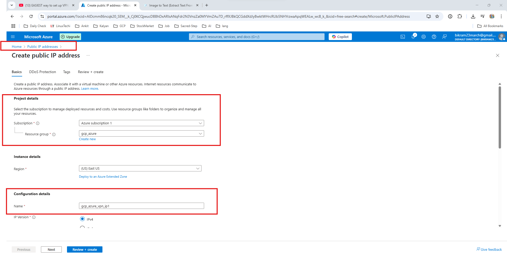

</td>
<td width="50%">

**Create IP 2**


</td>
</tr>
<tr>
<td width="50%">

**IP 1: `4.156.244.86`**
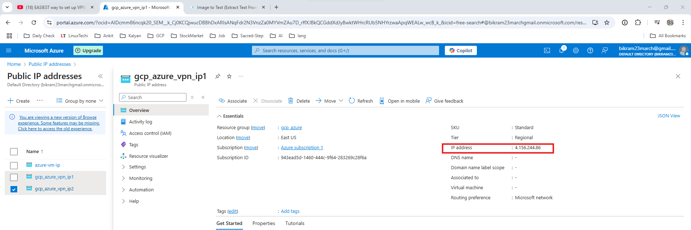

</td>
<td width="50%">

**IP 2: `135.234.206.228`**


</td>
</tr>
</table>

---

## 🔹 Step 7 · GCP HA VPN, Cloud Router & Tunnels

> 🧭 **Console path:** Network Connectivity → VPN → **Create VPN connection** → **High-availability (HA) VPN**

<table>
<tr>
<td width="50%">

**VPN landing page**
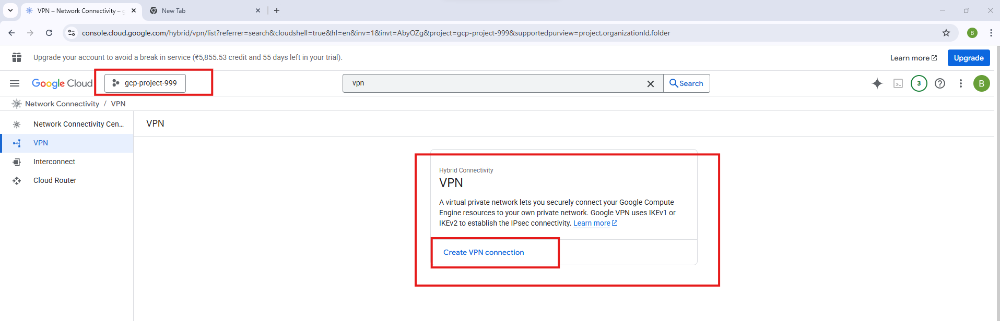

</td>
<td width="50%">

**Select High-availability (HA) VPN**
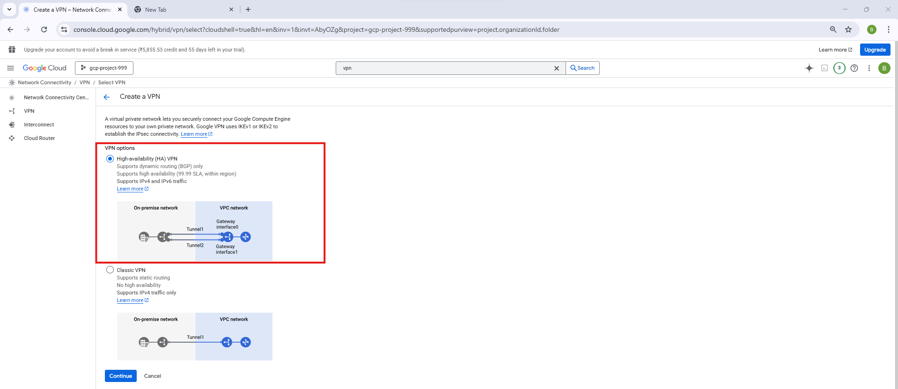

</td>
</tr>
</table>

### 7.1 · Create the HA VPN gateway

| Field | Value |
|---|---|
| Name | `gcp-to-azure-vpn` |
| Network | `gcp-azure-vpc` |
| Region | `us-east1` |
| Stack type | IPv4 (single-stack) |

Google allocates two public IPs: **`34.152.79.70`** (interface 0) and **`34.177.46.16`** (interface 1).

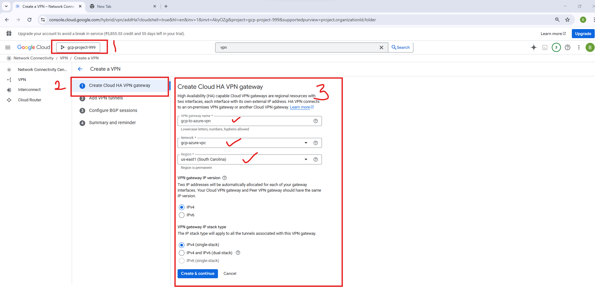

### 7.2 · Create the peer VPN gateway

**Add VPN tunnels → Peer VPN gateway → Create new peer VPN gateway**: name `gcp-to-azure-vpn-gateway`, **two interfaces**, entering the two Azure public IPs.

| Interface | IP |
|---|---|
| Interface 0 | `4.156.244.86` |
| Interface 1 | `135.234.206.228` |

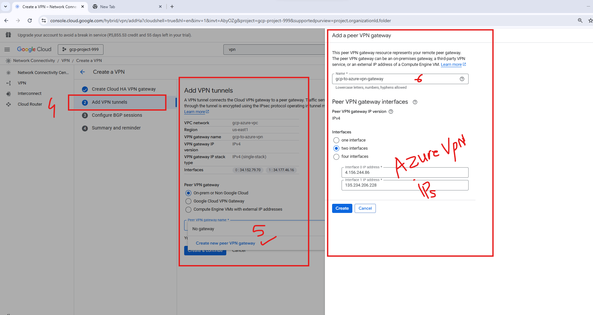

### 7.3 · Create the Cloud Router

**Cloud Router → Create new router**: name `gcp-to-azure-vpn-router`, network `gcp-azure-vpc`, **ASN `65001`**, advertise all subnets (default).

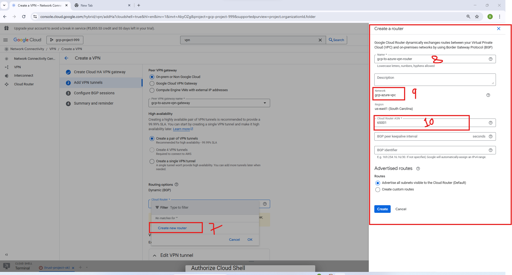

### 7.4 · Create the two tunnels

<table>
<tr>
<td width="50%">

**Tunnel 1**

| Field | Value |
|---|---|
| GCP interface | `0: 34.152.79.70` |
| Peer interface | `0: 4.156.244.86` |
| Name | `gcp-to-azure-vpn-tunnel-1` |
| IKE | IKEv2 |
| PSK | `<YOUR_SHARED_KEY>` |

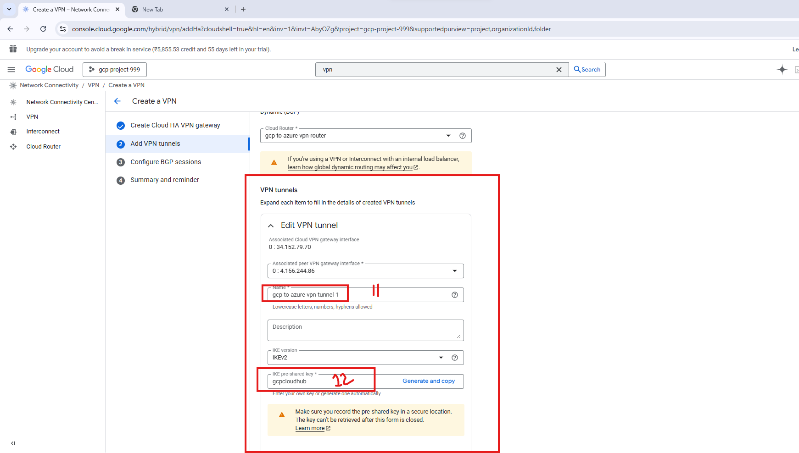

</td>
<td width="50%">

**Tunnel 2**

| Field | Value |
|---|---|
| GCP interface | `1: 34.177.46.16` |
| Peer interface | `1: 135.234.206.228` |
| Name | `gcp-to-azure-vpn-tunnel-2` |
| IKE | IKEv2 |
| PSK | same key as tunnel 1 |


</td>
</tr>
</table>

### 7.5 · Defer BGP

At **Configure BGP sessions**, choose **Configure BGP sessions later** (the Azure APIPA addresses and ASN don't exist yet) and save. The tunnels show **First handshake** until the Azure side is built. That is expected.

<table>
<tr>
<td width="50%">

**Configure BGP sessions later**
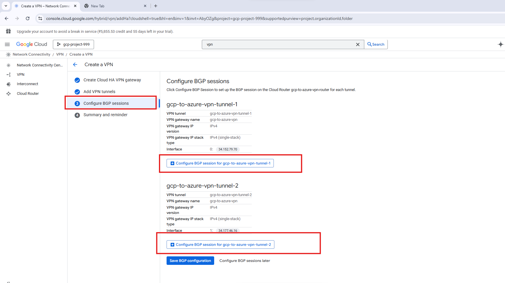

</td>
<td width="50%">

**Tunnels in "First handshake"**
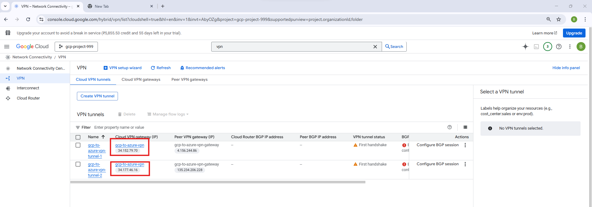

</td>
</tr>
</table>

---

## 🔹 Step 8 · Azure Active-Active VPN Gateway

**Virtual network gateways → Create.**

### 8.1 · Basics

| Field | Value |
|---|---|
| Name | `gcp_to_azure_vpn` ⚠️ *see naming note* |
| Region | East US |
| Gateway type | VPN |
| SKU | `VpnGw2AZ` (BGP needs a Standard-or-higher SKU) |
| Generation | Generation 2 |
| Virtual network | `gcp_azure_net` (picks up `GatewaySubnet`) |

> ⚠️ **Naming note:** in this demo the gateway ended up as `gcp_to_azure_vpn`. `azure_to_gcp_vpn` would describe the direction better. The screenshots use the former, so this guide does too.

<table>
<tr>
<td width="50%">

**Virtual network gateways: Create**
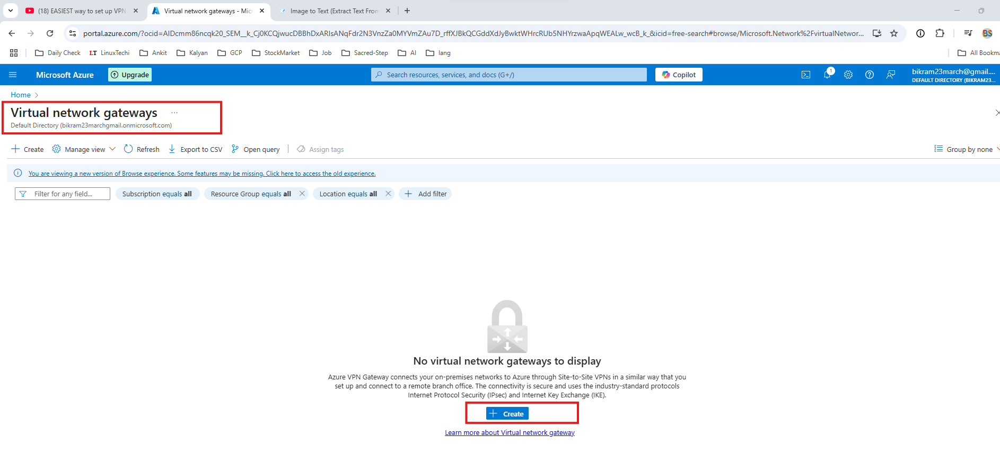

</td>
<td width="50%">

**Basics**
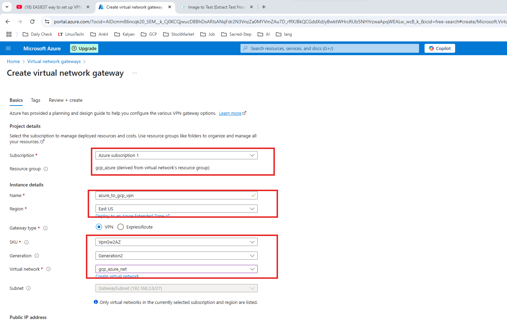

</td>
</tr>
</table>

### 8.2 · Public IPs, active-active and BGP

| Field | Value |
|---|---|
| Public IP address | **Use existing** → `gcp_azure_vpn_ip1` (`4.156.244.86`) |
| Enable active-active mode | ✅ **Enabled** |
| Second public IP | **Use existing** → `gcp_azure_vpn_ip2` (`135.234.206.228`) |
| Configure BGP | ✅ **Enabled** |
| ASN | **`65002`** |
| Custom Azure APIPA BGP IP addresses | **`169.254.21.2`** and **`169.254.22.2`** |


### 8.3 · Review and deploy

Confirm active-active **Enabled**, BGP **Enabled**, ASN `65002`, both APIPA addresses and both public IPs. VPN gateways are slow to provision, often **30–45 minutes**.

<table>
<tr>
<td width="50%">

**Review + create (validation passed)**
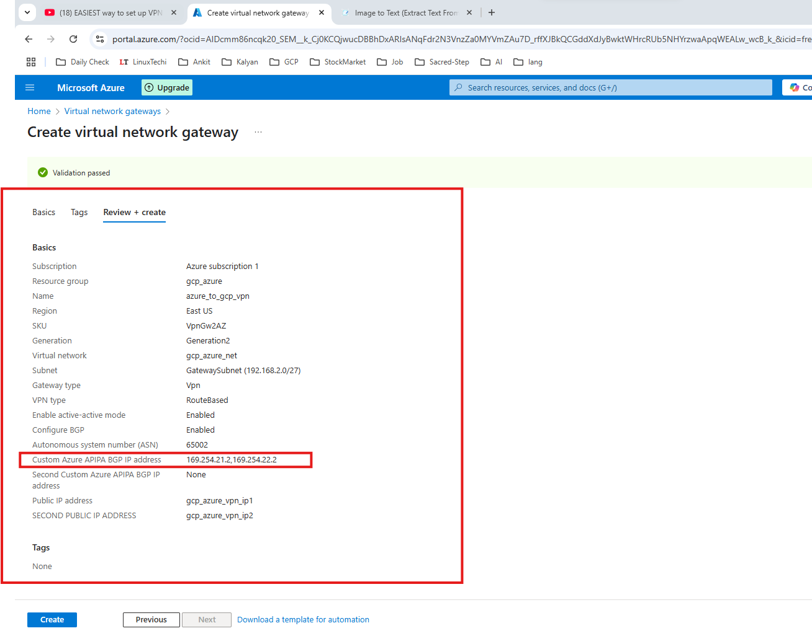

</td>
<td width="50%">

**Deployment complete**
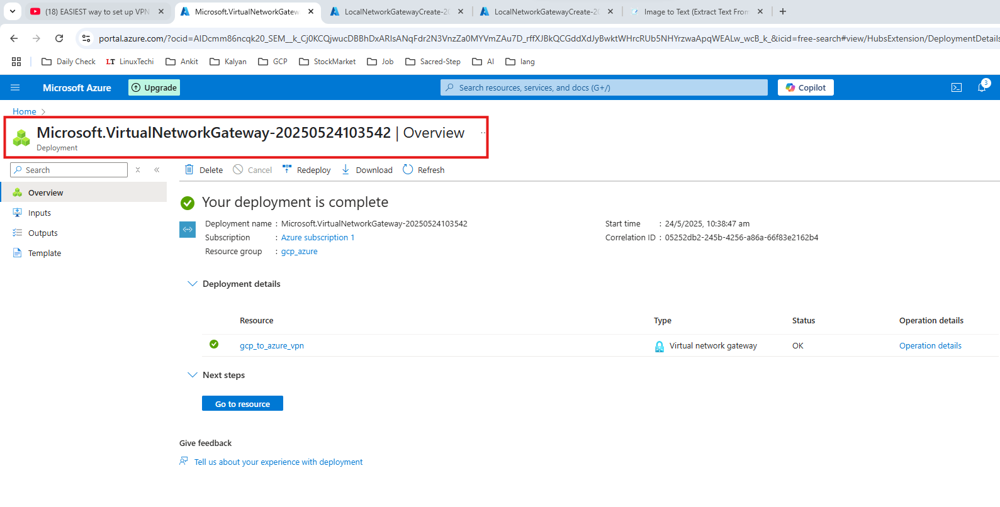

</td>
</tr>
</table>

---

## 🔹 Step 9 · Azure Local Network Gateways

You need **one LNG per GCP interface**. **Local network gateways → Create.**

| Setting | 📍 LNG 1 | 📍 LNG 2 |
|---|---|---|
| Name | `azure-t0-gcp-network-gateway-1` | `azure-t0-gcp-network-gateway-2` |
| Region / RG | East US / `gcp_azure` | East US / `gcp_azure` |
| Endpoint | IP address | IP address |
| IP address (GCP interface) | **`34.152.79.70`** | **`34.177.46.16`** |
| Address space | **`169.254.21.1/32`** | **`169.254.22.1/32`** |
| Configure BGP settings | **Yes** | **Yes** |
| ASN (Google's) | **`65001`** | **`65001`** |
| BGP peer IP address | **`169.254.21.1`** | **`169.254.22.1`** |

> 💡 Both LNGs use the **same Google ASN (`65001`)** because both GCP interfaces belong to the same Cloud Router. The BGP peer IP and `/32` address space must match the Cloud Router IP you assign in Step 11.

### LNG 1

<table>
<tr>
<td width="50%">

**Local network gateways list**


</td>
<td width="50%">

**Basics: Google IP + address space**


</td>
</tr>
<tr>
<td width="50%">

**Advanced: enable BGP**


</td>
<td width="50%">

**Advanced: Google ASN + BGP peer IP**
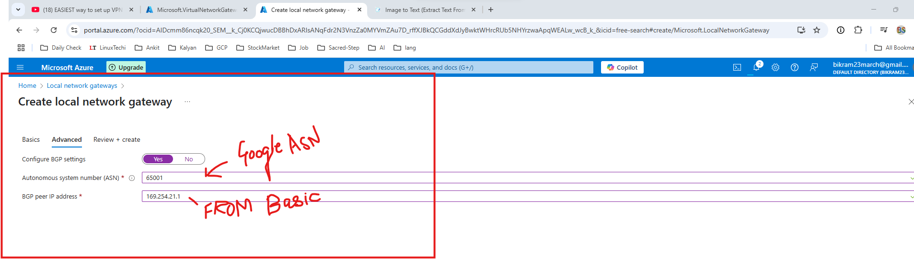

</td>
</tr>
</table>

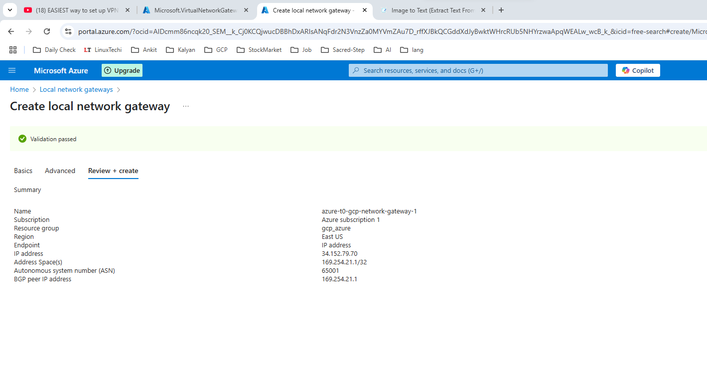

### LNG 2

<table>
<tr>
<td width="50%">

**Basics**


</td>
<td width="50%">

**Advanced**
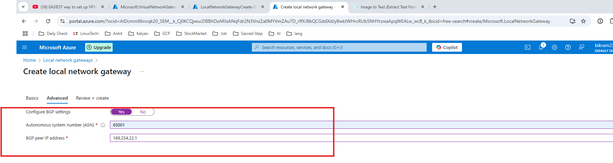

</td>
</tr>
<tr>
<td width="50%">

**Review**
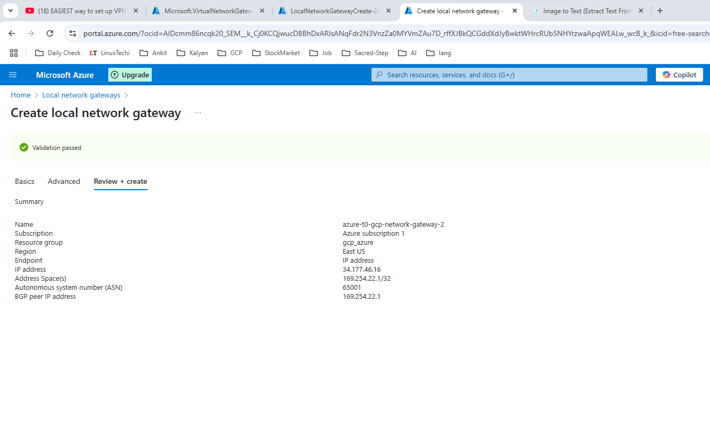

</td>
<td width="50%">

**Both deployments complete**

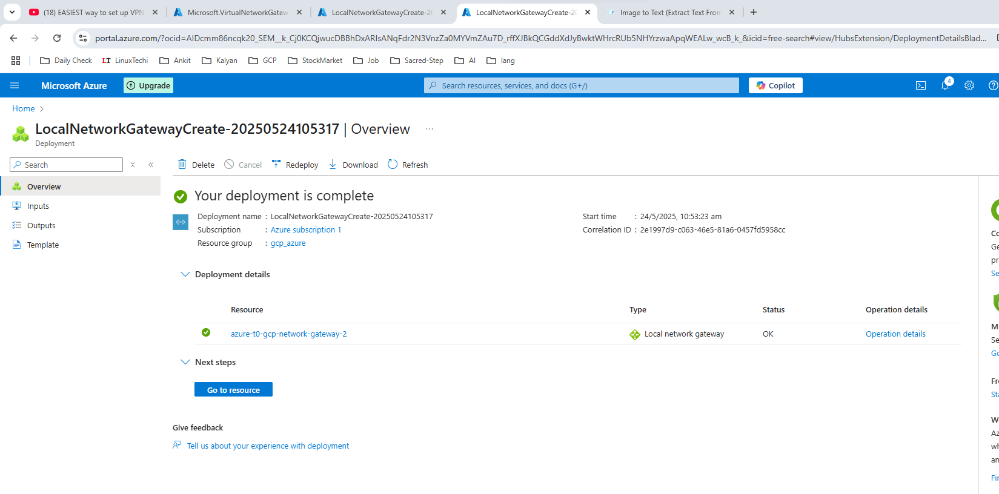

</td>
</tr>
</table>

---

## 🔹 Step 10 · Azure Connections

Open the virtual network gateway → **Settings → Connections → + Add.** Create **one connection per tunnel**.

<table>
<tr>
<td width="50%">

**Gateway overview → Connections**
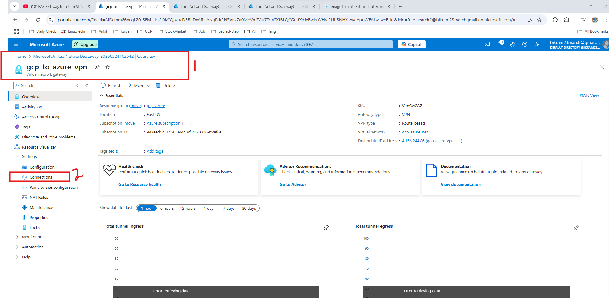

</td>
<td width="50%">

**Connections → Add**
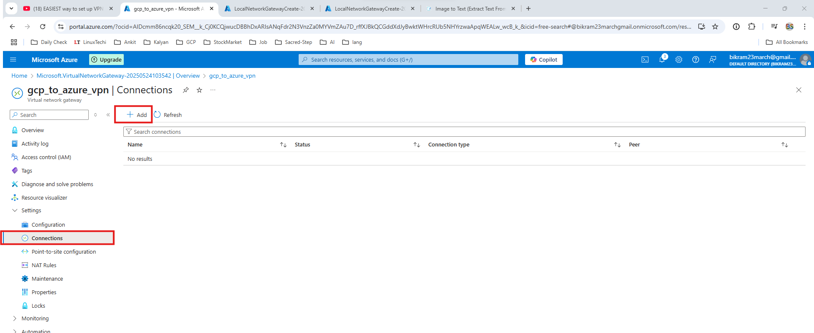

</td>
</tr>
</table>

| Setting | 🔗 Connection 1 | 🔗 Connection 2 |
|---|---|---|
| Connection type | Site-to-site (IPsec) | Site-to-site (IPsec) |
| Name | `azure-to-gcp-tunnel-1` | `azure-to-gcp-tunnel-2` |
| Virtual network gateway | `gcp_to_azure_vpn` | `gcp_to_azure_vpn` |
| Local network gateway | `azure-t0-gcp-network-gateway-1` | `azure-t0-gcp-network-gateway-2` |
| Authentication | Shared key (PSK) `<YOUR_SHARED_KEY>` | **same PSK** |
| IKE protocol | **IKEv2** | **IKEv2** |
| Enable BGP | ✅ Checked | ✅ Checked |
| IPsec/IKE policy | Default | Default |

### Connection 1

<table>
<tr>
<td width="33%">

**Basics**
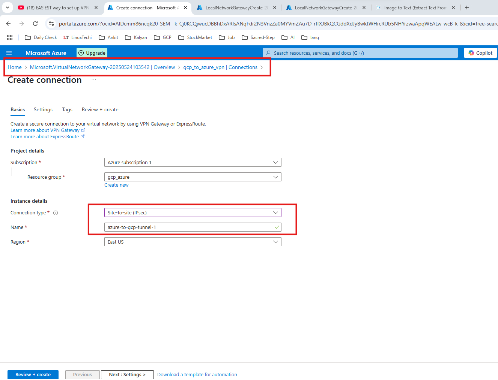

</td>
<td width="33%">

**Settings**
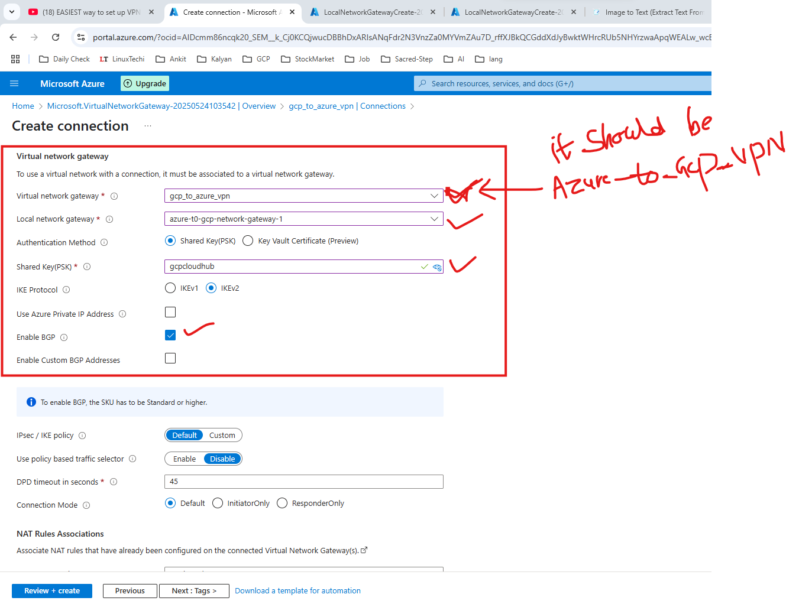

</td>
<td width="33%">

**Review**


</td>
</tr>
</table>

### Connection 2

<table>
<tr>
<td width="33%">

**Basics**
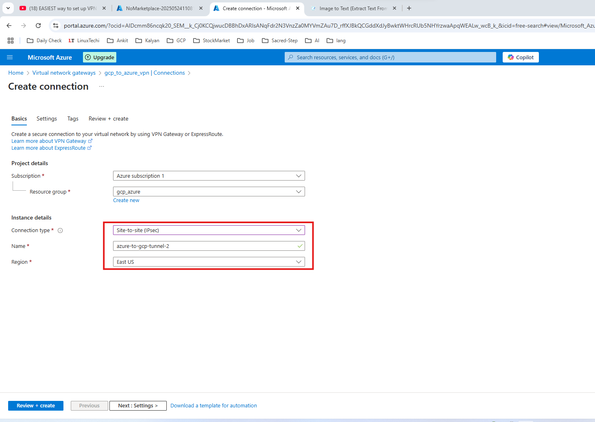

</td>
<td width="33%">

**Settings**
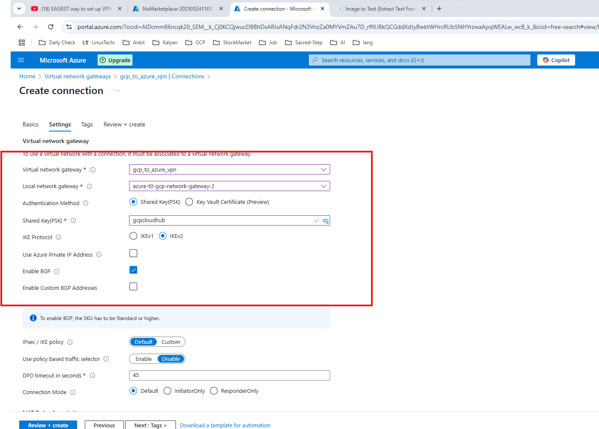

</td>
<td width="33%">

**Review**


</td>
</tr>
</table>

**Both deployments complete:**

<table>
<tr>
<td width="50%">

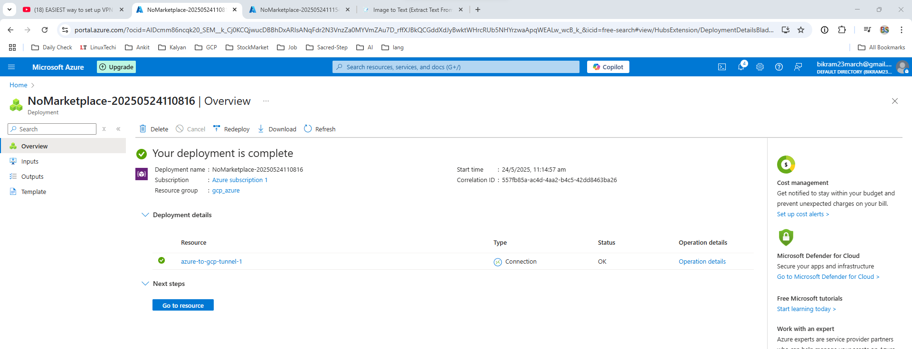

</td>
<td width="50%">


</td>
</tr>
</table>

---

## 🔹 Step 11 · GCP BGP Sessions

Back in GCP: **Network Connectivity → VPN → Cloud VPN tunnels** → **Configure BGP session** on each tunnel.

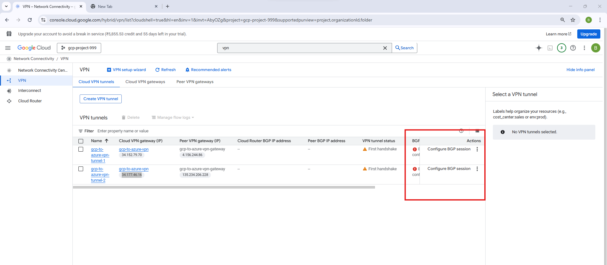

| Setting | 🟣 Tunnel 1 | 🟣 Tunnel 2 |
|---|---|---|
| Session name | `gcp-to-azure-bgp-1` | `gcp-project-bgp-2` *(suggest `gcp-to-azure-bgp-2`)* |
| Peer ASN | **`65002`** | **`65002`** |
| Allocate BGP IPv4 address | **Manually** | **Manually** |
| Cloud Router BGP IPv4 address | **`169.254.21.1`** | **`169.254.22.1`** |
| BGP peer IPv4 address | **`169.254.21.2`** | **`169.254.22.2`** |

<table>
<tr>
<td width="50%">

**Session 1: name + peer ASN**


</td>
<td width="50%">

**Session 1: manual APIPA addresses**
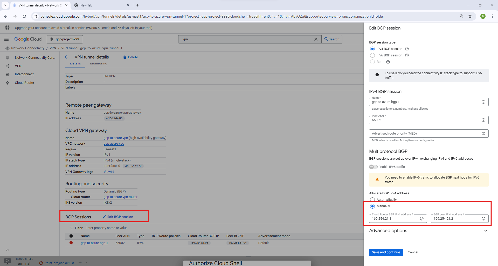

</td>
</tr>
<tr>
<td width="50%">

**Session 1: BGP established**


</td>
<td width="50%">

**Session 2: name, ASN, manual APIPA**


</td>
</tr>
</table>

🟢 **Both tunnels: Established · Both BGP sessions: BGP established**

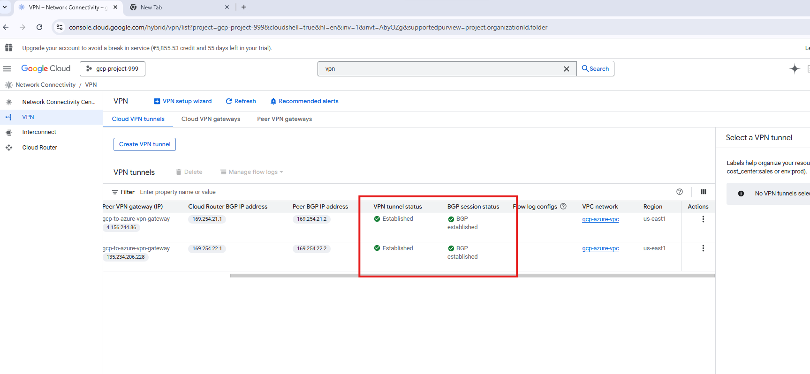

---

## 🔹 Step 12 · Validate

| Check | Expected |
|---|---|
| 🟢 GCP tunnels | Both **Established** |
| 🟣 GCP BGP sessions | Both **BGP established** |
| 🔷 Azure connections | Both **Connected** *(expected state; check in the portal)* |
| 🏓 `gcp-vm` → `192.168.0.4` | Replies, 0% loss |
| 🏓 `azure-vm` → `10.10.0.2` | Replies, 0% loss *(recommended reverse test, not captured in this build)* |

```bash
$ ping 192.168.0.4
64 bytes from 192.168.0.4: icmp_seq=1 ttl=63 time=16.3 ms
64 bytes from 192.168.0.4: icmp_seq=2 ttl=63 time=14.9 ms
64 bytes from 192.168.0.4: icmp_seq=3 ttl=63 time=15.1 ms
--- 192.168.0.4 ping statistics ---
3 packets transmitted, 3 received, 0% packet loss
rtt min/avg/max/mdev = 14.893/15.435/16.291/0.612 ms
```

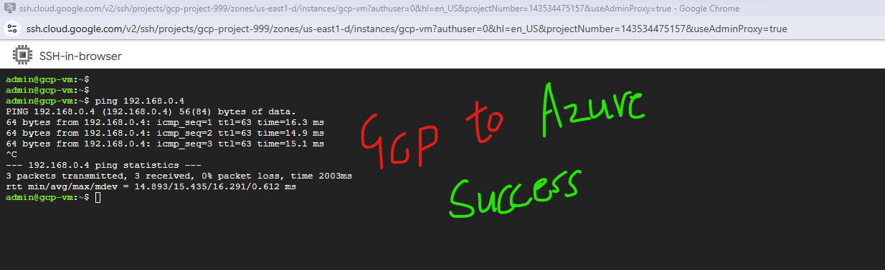

🎉 **Private connectivity between two clouds, about 15 ms round trip, with no static routes.**

> 🧪 **Optional HA test:** start a continuous ping, then delete or disable one tunnel. BGP withdraws that tunnel's routes and traffic continues over the other, with a brief blip.

---

## 🛡️ Gotchas Reference Table

| Area | Gotcha |
|---|---|
| 🧭 Order of operations | Create the Azure public IPs first, then GCP, then Azure gateway/LNGs/connections, and BGP on GCP last. Otherwise you are guessing IPs |
| 🔗 APIPA range | Azure only accepts `169.254.21.0`–`169.254.22.255` |
| 🔢 ASNs | Must differ between sides (eBGP). Both LNGs use the same Google ASN |
| 🎯 Matching values | LNG BGP peer IP = Cloud Router IP on GCP; GCP BGP peer IP = Azure APIPA IP. One typo and BGP never establishes |
| 🔀 BGP on both ends | Enable BGP on the Azure gateway **and** on each connection |
| 🔑 PSK | Identical on GCP tunnels and Azure connections |
| 🧱 GatewaySubnet | Must be named `GatewaySubnet`; `/27` or larger |
| 🌐 Overlap | `10.10.0.0/20` and `192.168.0.0/16` must not overlap |
| 🔥 Firewalls | VPN does not bypass GCP firewall rules or Azure NSGs. ICMP must be allowed |
| 🏷️ Naming | Name gateways by direction from the start (`azure_to_gcp_vpn`) |

---

## 🔧 Troubleshooting

| Symptom | Likely cause |
|---|---|
| Tunnel stuck on *First handshake* / *Waiting* | PSK mismatch, wrong peer IP, or IKE version mismatch (use IKEv2 on both sides). Note: it also stays here until the Azure side exists |
| Tunnel up but BGP **not** established | ASN mismatch, wrong BGP peer IP, or APIPA outside the allowed range |
| BGP up but ping fails | GCP firewall / Azure NSG not allowing ICMP, or overlapping address ranges |
| Azure connection *Not connected* | BGP enabled on the connection but not on the gateway (or the reverse), or PSK mismatch |
| Gateway deployment seems stuck | Normal: VPN gateways take 30–45 minutes |

---

## 💰 Cost & Cleanup

⚠️ **`VpnGw2AZ` and the two public IPs are billed while they exist.** Both clouds also charge for the VPN tunnels and egress data. See the official pricing pages before leaving this running.

**Cleanup**

1. 🔷 **Azure:** delete the resource group `gcp_azure` (removes the VNet, VMs, gateway, LNGs, connections and public IPs)
2. ☁️ **GCP:** delete the two VPN tunnels, the HA VPN gateway, the peer VPN gateway, the Cloud Router, `gcp-vm`, and finally the VPC `gcp-azure-vpc`

---

## 📸 Snapshots

Real screenshots taken directly from the Google Cloud and Azure consoles while building this demo, all under [`docs/snapshots/`](docs/snapshots), grouped by step.

| Folder | Step | Files |
|---|---|---|
| `00-architecture` | Architecture diagram | 1 |
| `01-azure-resource-group` | Resource group | 4 |
| `02-azure-vnet` | VNet, subnets, GatewaySubnet | 7 |
| `03-azure-vm` | Azure VM | 4 |
| `04-gcp-vpc-and-vm` | GCP VPC, VM, IPs | 3 |
| `05-ping-before-vpn` | Baseline failed ping | 1 |
| `06-azure-public-ips` | Two public IPs | 4 |
| `07-gcp-ha-vpn` | HA VPN gateway, router, tunnels | 9 |
| `08-azure-vnet-gateway` | Active-active VNG | 5 |
| `09-azure-local-network-gateways` | Two LNGs | 10 |
| `10-azure-connections` | Two connections | 10 |
| `11-gcp-bgp-sessions` | BGP sessions | 6 |
| `12-validation` | Successful ping | 1 |

---

## 🔗 Resources

- [Cloud VPN: HA VPN overview](https://cloud.google.com/network-connectivity/docs/vpn/concepts/overview)
- [Cloud Router overview](https://cloud.google.com/network-connectivity/docs/router)
- [Azure VPN Gateway: About](https://learn.microsoft.com/azure/vpn-gateway/vpn-gateway-about-vpngateways)
- [Azure VPN Gateway: BGP how-to](https://learn.microsoft.com/azure/vpn-gateway/bgp-howto)

---

<div align="center">

**Maintained by Bikram Singh**

*Built and verified hands-on with Google Cloud HA VPN and Azure VPN Gateway*

</div>
