# GCP HA VPN ↔ Azure Active-Active VPN Gateway with BGP

A hands-on, step-by-step guide (SOP style) to build a **dynamic, highly available site-to-site IPsec VPN between Google Cloud and Microsoft Azure**, using:

- **GCP HA VPN** (2 interfaces) + **Cloud Router** (BGP)
- **Azure VPN Gateway in Active-Active mode** (2 public IPs) with **BGP + APIPA addresses**
- **2 IPsec/IKEv2 tunnels** and **2 BGP sessions**, so either tunnel can fail without dropping traffic

Everything is done from the cloud consoles (no Terraform in this guide) and validated with a private-IP ping between a VM in each cloud.

---

## Table of Contents

1. [Architecture](#1-architecture)
2. [Theory: the concepts you need](#2-theory-the-concepts-you-need)
3. [Design and addressing plan](#3-design-and-addressing-plan)
4. [Prerequisites](#4-prerequisites)
5. [Step 1: Azure resource group](#step-1-azure-resource-group)
6. [Step 2: Azure virtual network and subnets](#step-2-azure-virtual-network-and-subnets)
7. [Step 3: Azure VM](#step-3-azure-vm)
8. [Step 4: GCP VPC and VM](#step-4-gcp-vpc-and-vm)
9. [Step 5: Baseline ping test (before VPN)](#step-5-baseline-ping-test-before-vpn)
10. [Step 6: Azure public IPs for the VPN gateway](#step-6-azure-public-ips-for-the-vpn-gateway)
11. [Step 7: GCP HA VPN gateway, Cloud Router and tunnels](#step-7-gcp-ha-vpn-gateway-cloud-router-and-tunnels)
12. [Step 8: Azure active-active virtual network gateway](#step-8-azure-active-active-virtual-network-gateway)
13. [Step 9: Azure local network gateways](#step-9-azure-local-network-gateways)
14. [Step 10: Azure connections](#step-10-azure-connections)
15. [Step 11: GCP BGP sessions](#step-11-gcp-bgp-sessions)
16. [Step 12: Validate](#step-12-validate)
17. [Troubleshooting](#troubleshooting)
18. [Cleanup](#cleanup)
19. [Repository layout](#repository-layout)

---

## 1. Architecture

```
            GCP (us-east1)                                  Azure (East US)
  ┌─────────────────────────────┐                 ┌──────────────────────────────────┐
  │ VPC: gcp-azure-vpc          │                 │ VNet: gcp_azure_net              │
  │ 10.10.0.0/20                │                 │ 192.168.0.0/16                   │
  │  └─ gcp-vm   10.10.0.2      │                 │  ├─ gcp_azure_east-us 192.168.0.0/24 │
  │                             │                 │  │    └─ azure-vm  192.168.0.4  │
  │ HA VPN GW: gcp-to-azure-vpn │                 │  └─ GatewaySubnet 192.168.2.0/27 │
  │  if0 34.152.79.70 ──────────┼── Tunnel 1 ─────┼── 4.156.244.86     (VNG instance 1)
  │  if1 34.177.46.16 ──────────┼── Tunnel 2 ─────┼── 135.234.206.228  (VNG instance 2)
  │                             │   IPsec/IKEv2   │ VNG: active-active, VpnGw2AZ     │
  │ Cloud Router  ASN 65001     │◄──── BGP ──────►│ BGP ASN 65002                    │
  │  169.254.21.1 / 169.254.22.1│  (APIPA /30s)   │  169.254.21.2 / 169.254.22.2     │
  └─────────────────────────────┘                 └──────────────────────────────────┘
```

| Tunnel | GCP interface | Azure gateway IP | GCP BGP IP | Azure BGP IP |
|---|---|---|---|---|
| Tunnel 1 | `34.152.79.70` (if0) | `4.156.244.86` | `169.254.21.1` | `169.254.21.2` |
| Tunnel 2 | `34.177.46.16` (if1) | `135.234.206.228` | `169.254.22.1` | `169.254.22.2` |

---

## 2. Theory: the concepts you need

**Site-to-site IPsec VPN.** An encrypted tunnel over the public internet between two networks. Both sides need a public IP for the tunnel endpoint, an agreed IKE version (we use **IKEv2**) and a **pre-shared key (PSK)**.

**GCP HA VPN.** A regional Cloud VPN gateway with **two interfaces**, each with its own public IP. With a tunnel on each interface connected to a peer, Google offers a 99.99% availability SLA. HA VPN supports only **dynamic routing (BGP)**.

**Cloud Router.** The BGP speaker on the GCP side. It learns the Azure prefixes from the peer and advertises the VPC subnets to it. It has its own ASN (here `65001`).

**Azure VPN Gateway, active-active.** A normal Azure VPN gateway is two instances, one active and one standby. In **active-active** mode both instances are active, each with its own public IP, so you can build two tunnels, one per instance. This pairs naturally with the two HA VPN interfaces.

**Local Network Gateway (LNG).** Azure's object that represents the *remote* site: its public IP (the GCP interface), its BGP ASN and its BGP peer IP. You need **one LNG per GCP interface** in this design.

**BGP and APIPA.** BGP exchanges routes dynamically, so no static routes are needed and a failed tunnel is withdrawn automatically. The BGP peers talk over link-local **APIPA** addresses (`169.254.x.x`). Azure only accepts APIPA addresses in `169.254.21.0`–`169.254.22.255`, which is why this guide uses `169.254.21.x` and `169.254.22.x`.

**ASNs.** The two sides must use *different* private ASNs (eBGP). This guide uses `65001` for GCP and `65002` for Azure. Azure reserves some ASNs, so avoid `65515` for the peer.

---

## 3. Design and addressing plan

| Item | GCP | Azure |
|---|---|---|
| Region | `us-east1` | East US |
| Network | VPC `gcp-azure-vpc` (custom mode) | VNet `gcp_azure_net` `192.168.0.0/16` |
| Workload subnet | `subnet-east-us` `10.10.0.0/20` | `gcp_azure_east-us` `192.168.0.0/24` |
| Gateway subnet | not needed | `GatewaySubnet` `192.168.2.0/27` |
| Test VM | `gcp-vm` `10.10.0.2` (e2-medium, `us-east1-d`) | `azure-vm` `192.168.0.4` (Ubuntu 24.04, B1s) |
| VPN gateway | HA VPN `gcp-to-azure-vpn` | VNG `gcp_to_azure_vpn`, `VpnGw2AZ`, Gen2, active-active |
| BGP ASN | `65001` (Cloud Router `gcp-to-azure-vpn-router`) | `65002` |
| IKE / PSK | IKEv2 / `<YOUR_SHARED_KEY>` | IKEv2 / same key |

> **Important:** the two private ranges (`10.10.0.0/20` and `192.168.0.0/16`) must **not overlap**.

> **Use your own PSK.** Don't reuse the key from the screenshots. Generate a long random one, for example `openssl rand -base64 32`.

---

## 4. Prerequisites

- A GCP project with billing enabled and the Compute Engine API on
- An Azure subscription (a free trial works, but **VpnGw2AZ is billed hourly**, see [Cleanup](#cleanup))
- Permission to create networking resources in both clouds
- Firewall rules that allow what you test:
  - GCP: allow ICMP (and SSH) from `192.168.0.0/16` on `gcp-azure-vpc`
  - Azure: the VM's NSG must allow ICMP from `10.10.0.0/20` (the default VNet rules usually cover traffic arriving over a connected gateway)

---

## Step 1: Azure resource group

Create a resource group to hold everything Azure-side: **Resource groups → Create**.

| Field | Value |
|---|---|
| Subscription | your subscription |
| Resource group | `gcp_azure` |
| Region | East US |

| | |
|---|---|
|  | 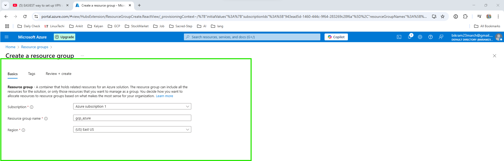 |
| 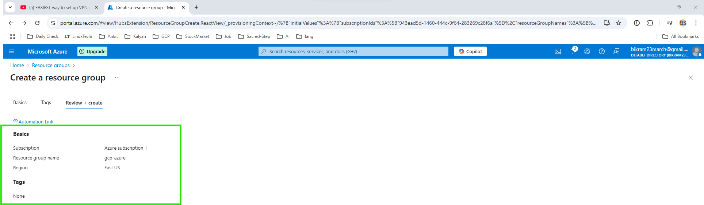 | 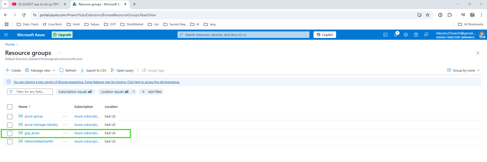 |

---

## Step 2: Azure virtual network and subnets

1. **All services → Virtual networks → Create.**

   

2. **Basics:** resource group `gcp_azure`, name `gcp_azure_net`, region East US.

   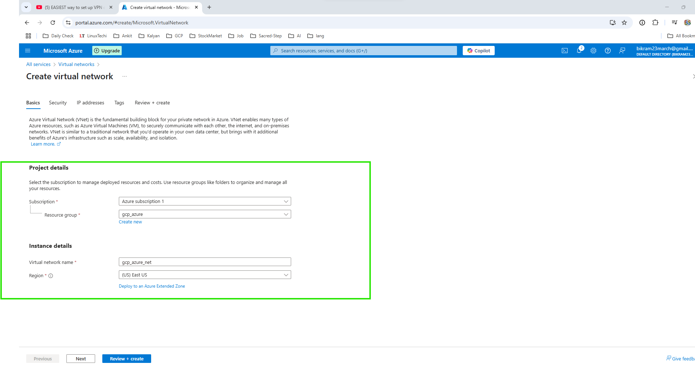

3. **IP addresses:** address space `192.168.0.0/16`. Edit the `default` subnet: name `gcp_azure_east-us`, range `192.168.0.0/24`.

   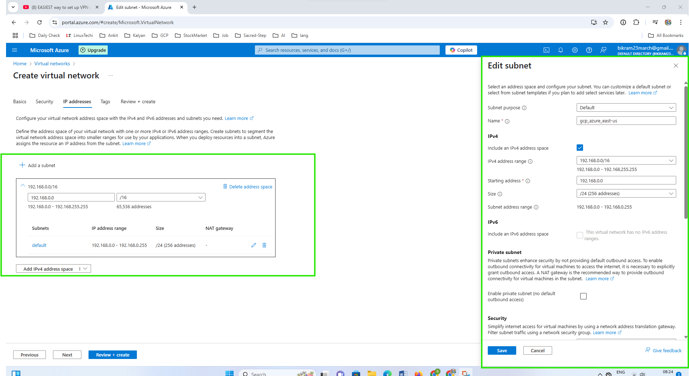
   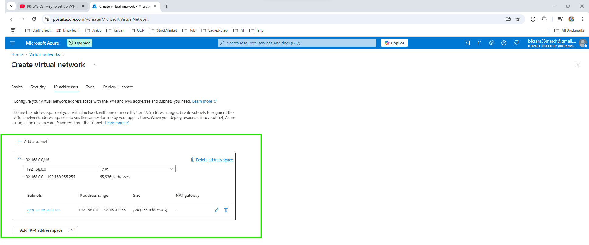

4. **Review + create.**

   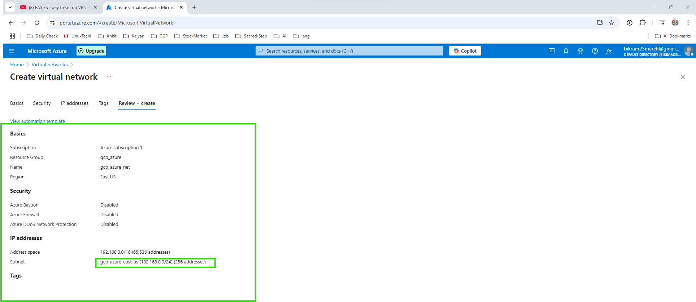

5. **Add the gateway subnet.** Open the VNet → **Subnets → + Subnet**:
   - Subnet purpose: **Virtual Network Gateway** (the name is fixed as `GatewaySubnet`)
   - Starting address `192.168.2.0`, size `/27`

   
   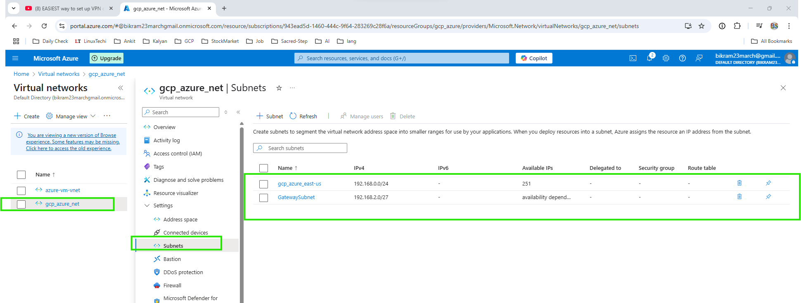

> A `/27` is the minimum Microsoft recommends for the gateway subnet.

---

## Step 3: Azure VM

**Virtual machines → Create → Azure virtual machine.**

| Field | Value |
|---|---|
| Resource group | `gcp_azure` |
| Name | `azure-vm` |
| Region | East US |
| Image | Ubuntu Server 24.04 LTS (x64 Gen2) |
| Networking | VNet `gcp_azure_net`, subnet `gcp_azure_east-us`, new public IP, NSG **Basic**, allow **SSH (22)** |

| | |
|---|---|
| 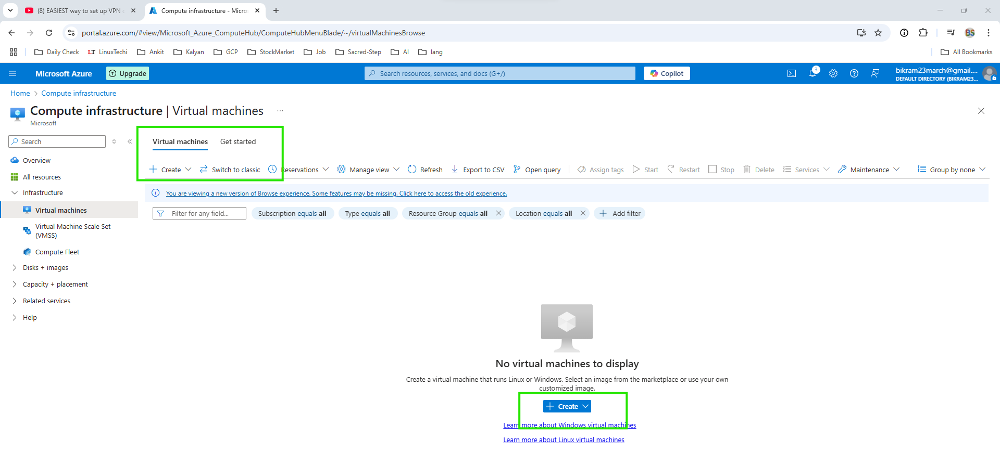 | 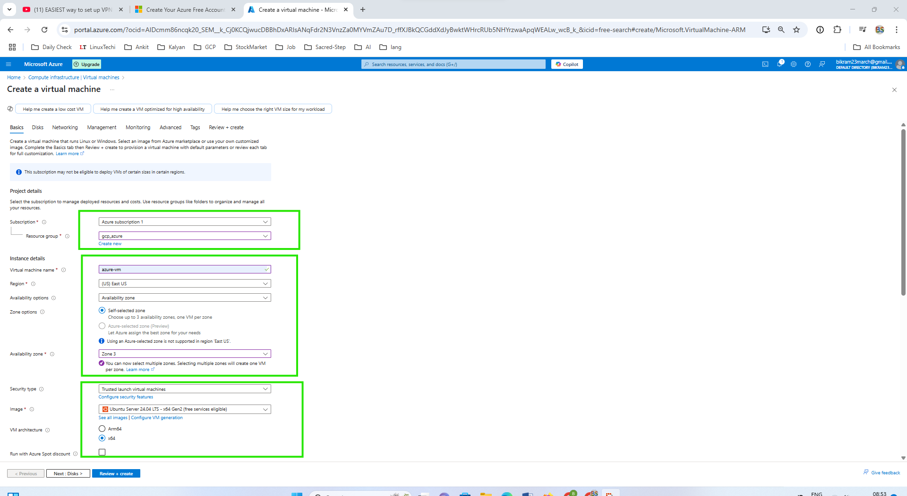 |
| 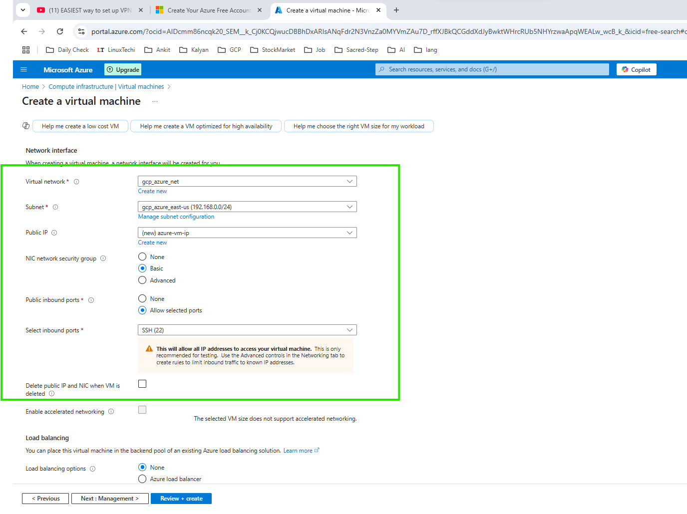 |  |

Result: **Azure VM private IP `192.168.0.4`**.

---

## Step 4: GCP VPC and VM

1. **VPC network → Create VPC network**
   - Name `gcp-azure-vpc`, subnet creation mode **Custom**
   - Subnet `subnet-east-us`, region `us-east1`, IPv4 range `10.10.0.0/20`

   

2. **Compute Engine → create `gcp-vm`** in `us-east1-d` on `gcp-azure-vpc` / `subnet-east-us`. Add a firewall rule that allows ICMP and SSH.

   Result: **GCP VM private IP `10.10.0.2`**.

   
   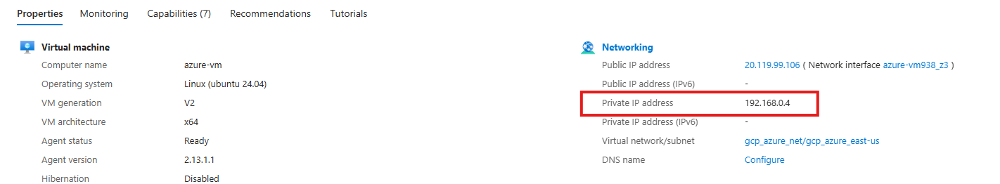

---

## Step 5: Baseline ping test (before VPN)

Ping each VM from the other, using the **private IP**. It must **fail** now, because there is no path between the two private networks yet.

```bash
# on gcp-vm
ping 192.168.0.4
# on azure-vm (Azure Cloud Shell / SSH)
ping 10.10.0.2
```

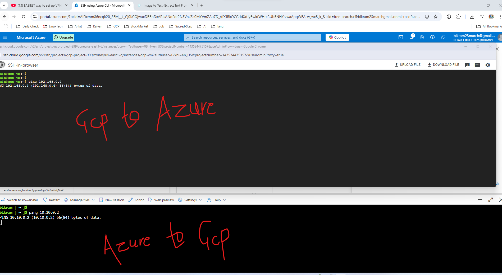

---

## Step 6: Azure public IPs for the VPN gateway

An active-active gateway needs **two** Standard public IPs. Create them first so we know them before configuring GCP.

**Public IP addresses → Create**, twice:

| Name | SKU / Tier | Region | Result |
|---|---|---|---|
| `gcp_azure_vpn_ip1` | Standard / Regional, IPv4 | East US | `4.156.244.86` |
| `gcp_azure_vpn_ip2` | Standard / Regional, IPv4 | East US | `135.234.206.228` |

| | |
|---|---|
|  | 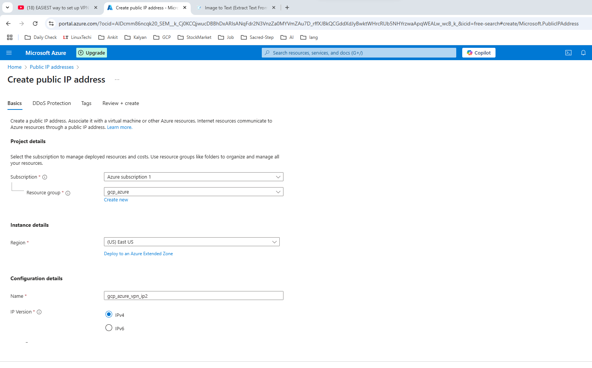 |
|  | 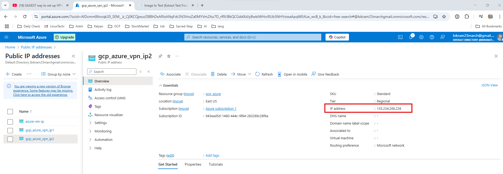 |

---

## Step 7: GCP HA VPN gateway, Cloud Router and tunnels

> Console path: **Network Connectivity → VPN → Create VPN connection**.

1. Choose **High-availability (HA) VPN → Continue**.

   
   

2. **Create Cloud HA VPN gateway**

   | Field | Value |
   |---|---|
   | Name | `gcp-to-azure-vpn` |
   | Network | `gcp-azure-vpc` |
   | Region | `us-east1` |
   | Stack type | IPv4 (single-stack) |

   Click **Create & continue**. Google allocates two public IPs: **`34.152.79.70`** (interface 0) and **`34.177.46.16`** (interface 1).

   

3. **Add VPN tunnels → Peer VPN gateway → Create new peer VPN gateway**
   - Name `gcp-to-azure-vpn-gateway`
   - Interfaces: **two interfaces**
     - Interface 0 IP: `4.156.244.86` (Azure IP 1)
     - Interface 1 IP: `135.234.206.228` (Azure IP 2)

   

4. **Create the Cloud Router.** In *Cloud Router → Create new router*:
   - Name `gcp-to-azure-vpn-router`, network `gcp-azure-vpc`
   - **Google ASN `65001`**
   - Advertised routes: *Advertise all subnets visible to the Cloud Router (Default)*

   

5. **Tunnel 1:**

   | Field | Value |
   |---|---|
   | Associated Cloud VPN gateway interface | `0: 34.152.79.70` |
   | Associated peer VPN gateway interface | `0: 4.156.244.86` |
   | Name | `gcp-to-azure-vpn-tunnel-1` |
   | IKE version | IKEv2 |
   | IKE pre-shared key | `<YOUR_SHARED_KEY>` |

   

6. **Tunnel 2:**

   | Field | Value |
   |---|---|
   | Associated Cloud VPN gateway interface | `1: 34.177.46.16` |
   | Associated peer VPN gateway interface | `1: 135.234.206.228` |
   | Name | `gcp-to-azure-vpn-tunnel-2` |
   | IKE version | IKEv2 |
   | IKE pre-shared key | same key as tunnel 1 |

   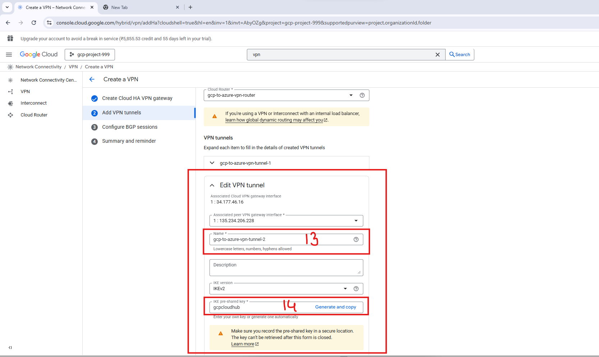

7. At **Configure BGP sessions**, choose **Configure BGP sessions later** (we need the Azure APIPA addresses first), then **Save**.

   

8. The tunnels appear with **First handshake** status and BGP not configured. This is expected until Azure is ready.

   

---

## Step 8: Azure active-active virtual network gateway

**Virtual network gateways → Create**.

1. **Basics**

   | Field | Value |
   |---|---|
   | Name | `gcp_to_azure_vpn` (see the naming note below) |
   | Region | East US |
   | Gateway type | VPN |
   | SKU | `VpnGw2AZ` (BGP needs a Standard-or-higher SKU) |
   | Generation | Generation 2 |
   | Virtual network | `gcp_azure_net` (picks up `GatewaySubnet`) |

   
   

   > **Naming note:** in my demo the gateway ended up as `gcp_to_azure_vpn`. A name like `azure_to_gcp_vpn` would describe the direction better. The screenshots in this repo use the former, so the rest of the guide does too.

2. **Public IP, active-active and BGP**

   | Field | Value |
   |---|---|
   | Public IP address | **Use existing** → `gcp_azure_vpn_ip1` (`4.156.244.86`) |
   | Enable active-active mode | **Enabled** |
   | Second public IP | **Use existing** → `gcp_azure_vpn_ip2` (`135.234.206.228`) |
   | Configure BGP | **Enabled** |
   | Autonomous system number (ASN) | **`65002`** |
   | Custom Azure APIPA BGP IP address | **`169.254.21.2`** (first), **`169.254.22.2`** (second) |

   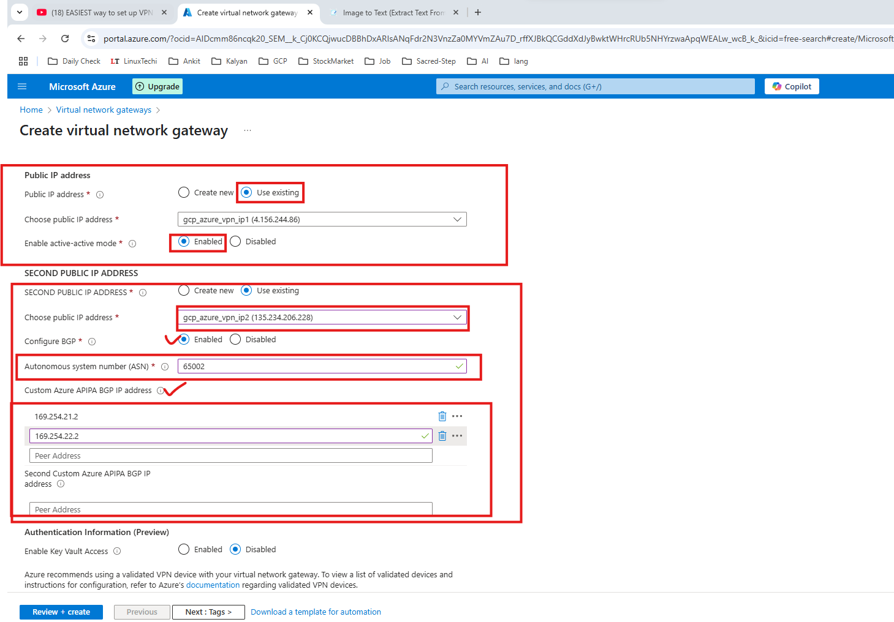

3. **Review + create → Create.** Check the review page: active-active **Enabled**, BGP **Enabled**, ASN `65002`, both APIPA addresses, both public IPs.

   

4. Wait for the deployment to complete. VPN gateways are slow to provision, often **30–45 minutes**.

   

---

## Step 9: Azure local network gateways

You need one LNG per GCP interface. **Local network gateways → Create**.

### LNG 1: represents GCP interface 0

| Tab | Field | Value |
|---|---|---|
| Basics | Name | `azure-t0-gcp-network-gateway-1` |
| Basics | Region / RG | East US / `gcp_azure` |
| Basics | Endpoint | IP address |
| Basics | IP address | **`34.152.79.70`** (GCP interface 0) |
| Basics | Address space | **`169.254.21.1/32`** (GCP's BGP IP) |
| Advanced | Configure BGP settings | **Yes** |
| Advanced | ASN | **`65001`** (Google's ASN) |
| Advanced | BGP peer IP address | **`169.254.21.1`** |

| | |
|---|---|
| 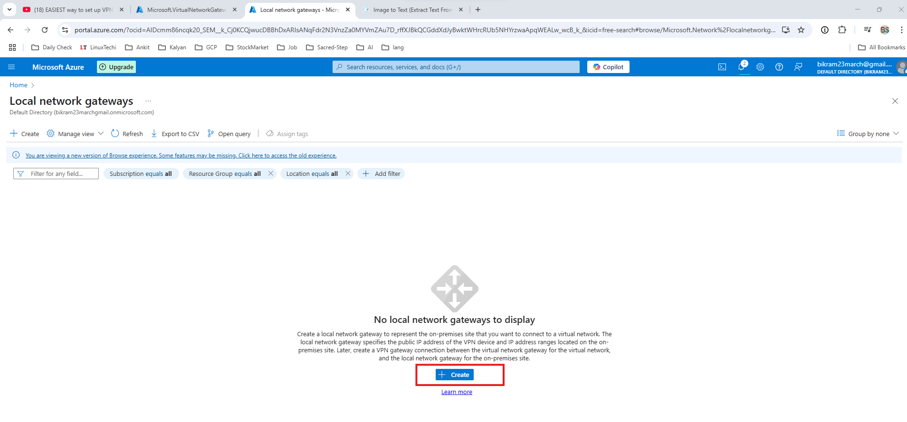 | 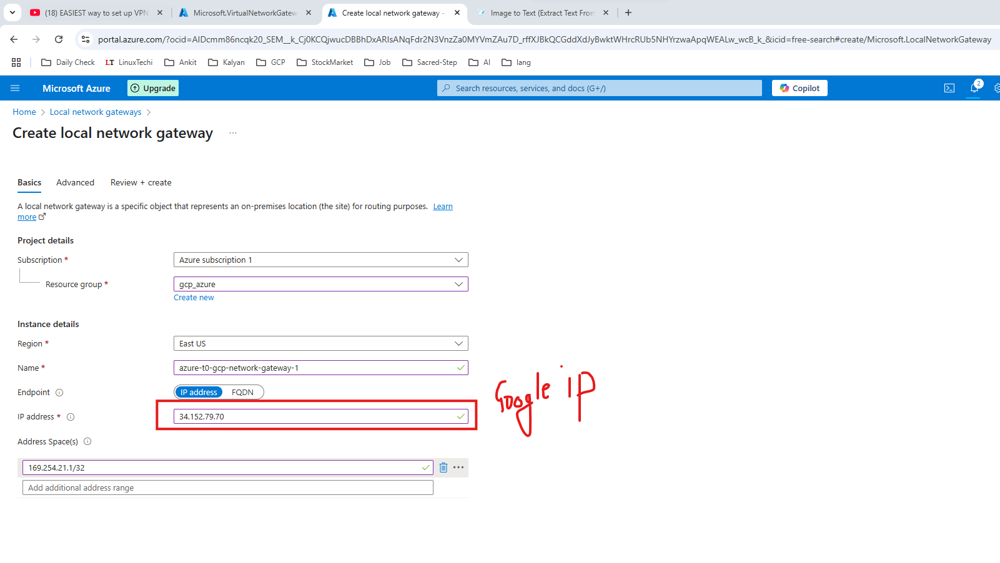 |
| 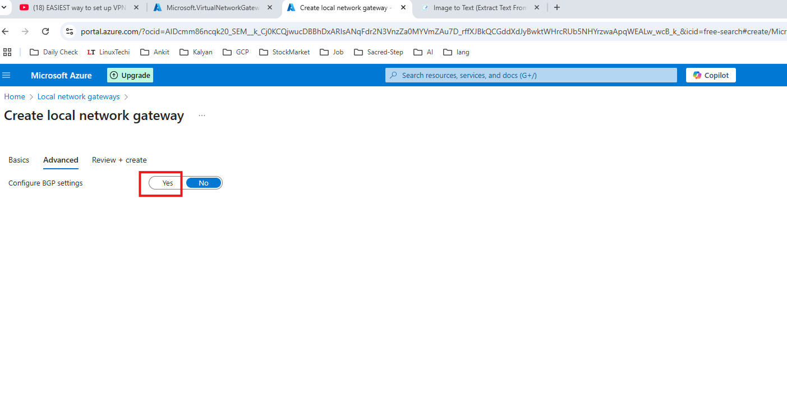 |  |


### LNG 2: represents GCP interface 1

| Tab | Field | Value |
|---|---|---|
| Basics | Name | `azure-t0-gcp-network-gateway-2` |
| Basics | IP address | **`34.177.46.16`** (GCP interface 1) |
| Basics | Address space | **`169.254.22.1/32`** |
| Advanced | Configure BGP settings | **Yes** |
| Advanced | ASN | **`65001`** |
| Advanced | BGP peer IP address | **`169.254.22.1`** |

| | |
|---|---|
| 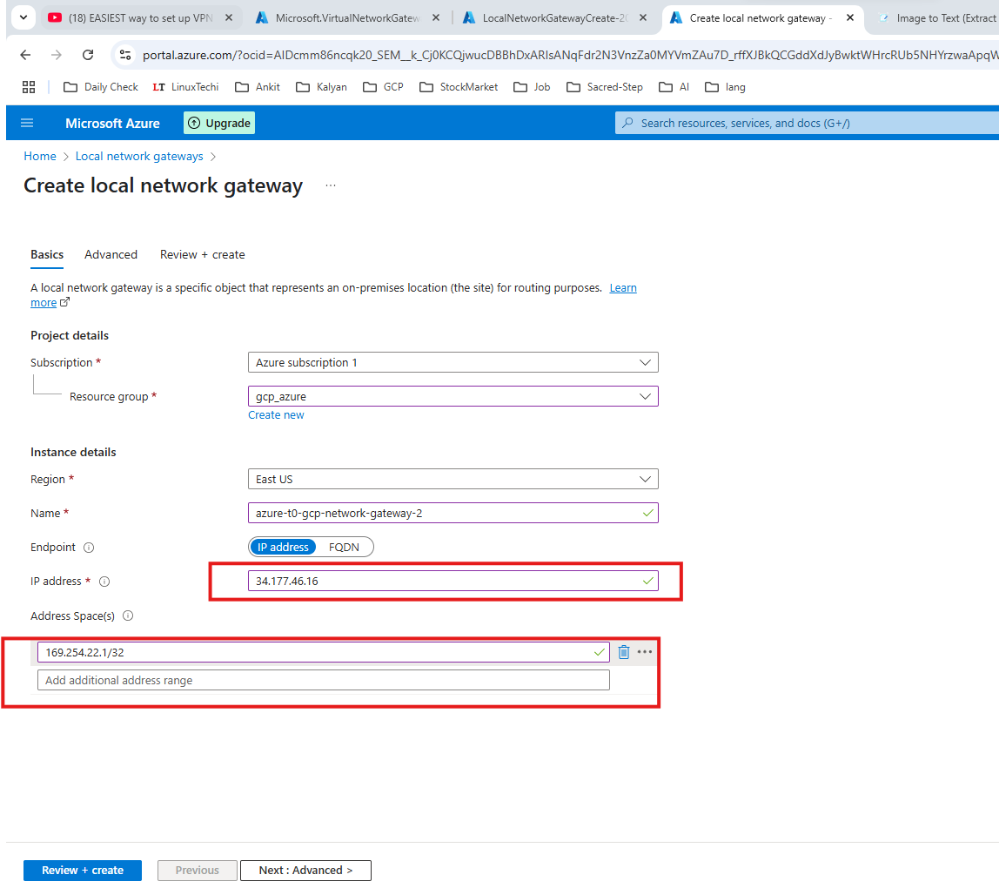 |  |
|  | 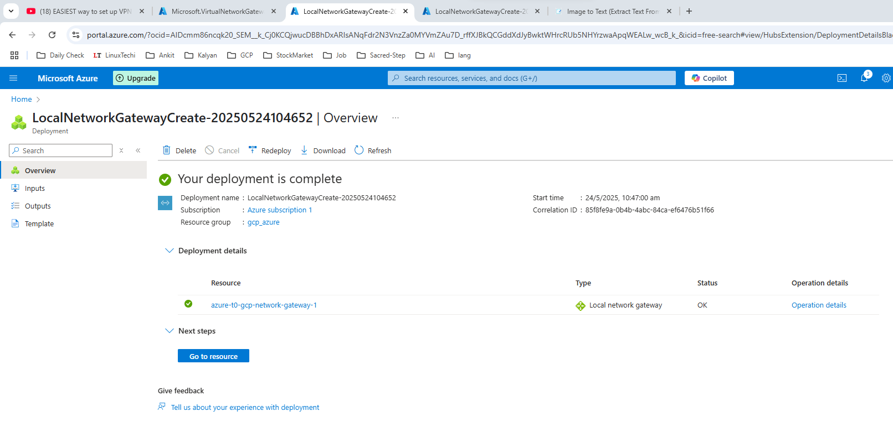 |


> Both LNGs use the **same Google ASN (65001)**, because both GCP interfaces belong to the same Cloud Router. The BGP peer IP and the `/32` address space must match the Cloud Router IP you assign in Step 11.

---

## Step 10: Azure connections

Open the virtual network gateway → **Settings → Connections → + Add**. Create one connection per tunnel.


### Connection 1

| Field | Value |
|---|---|
| Connection type | Site-to-site (IPsec) |
| Name | `azure-to-gcp-tunnel-1` |
| Virtual network gateway | `gcp_to_azure_vpn` |
| Local network gateway | `azure-t0-gcp-network-gateway-1` |
| Authentication | Shared key (PSK) = `<YOUR_SHARED_KEY>` |
| IKE protocol | **IKEv2** |
| Enable BGP | **Checked** |
| IPsec/IKE policy | Default |


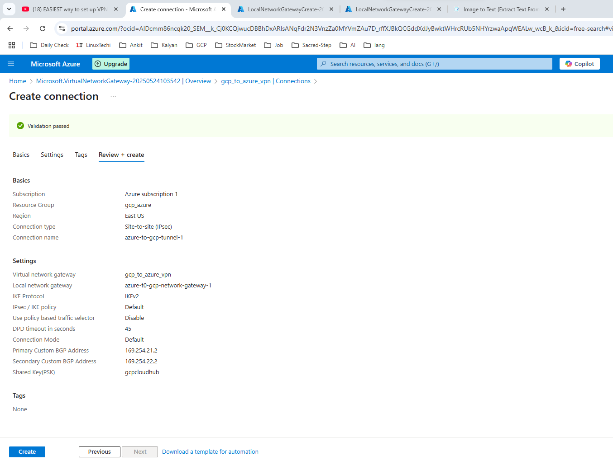

### Connection 2

Same as connection 1, but name `azure-to-gcp-tunnel-2` and local network gateway `azure-t0-gcp-network-gateway-2`. Use the **same PSK**.


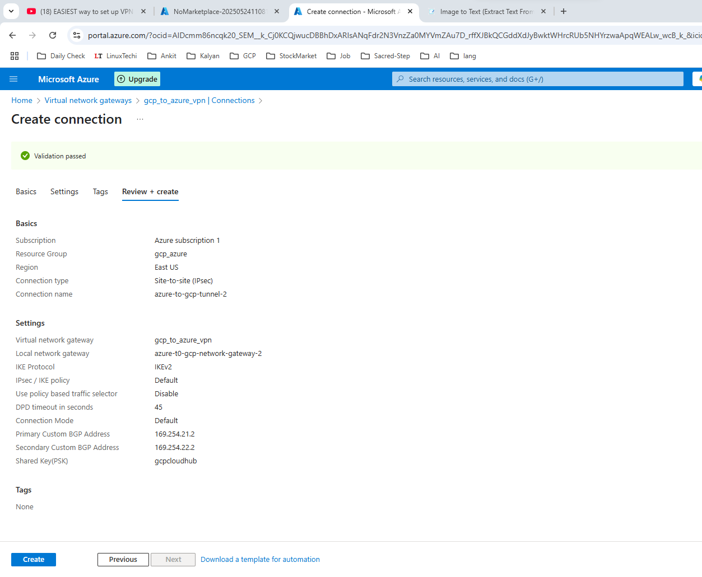

Wait for both deployments to finish:


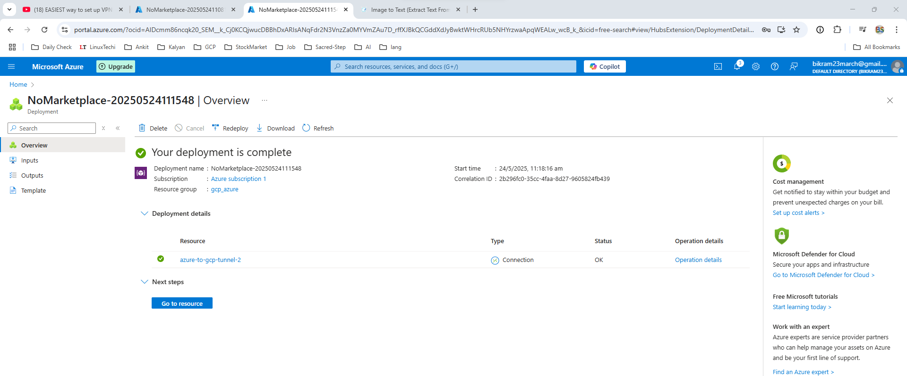

---

## Step 11: GCP BGP sessions

Back in GCP: **Network Connectivity → VPN → Cloud VPN tunnels**. Both tunnels now need their BGP session. Click **Configure BGP session** on each.


### BGP session for tunnel 1

| Field | Value |
|---|---|
| Name | `gcp-to-azure-bgp-1` |
| Peer ASN | **`65002`** (Azure) |
| Allocate BGP IPv4 address | **Manually** |
| Cloud Router BGP IPv4 address | **`169.254.21.1`** |
| BGP peer IPv4 address | **`169.254.21.2`** |

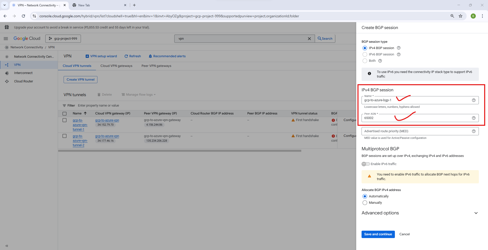

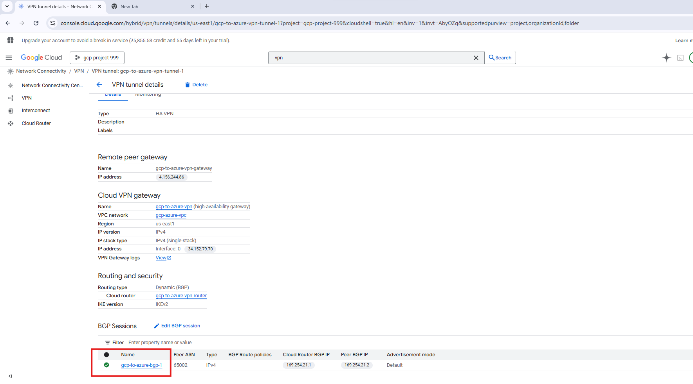

### BGP session for tunnel 2

| Field | Value |
|---|---|
| Name | `gcp-project-bgp-2` (I'd suggest `gcp-to-azure-bgp-2`) |
| Peer ASN | **`65002`** |
| Allocate BGP IPv4 address | **Manually** |
| Cloud Router BGP IPv4 address | **`169.254.22.1`** |
| BGP peer IPv4 address | **`169.254.22.2`** |

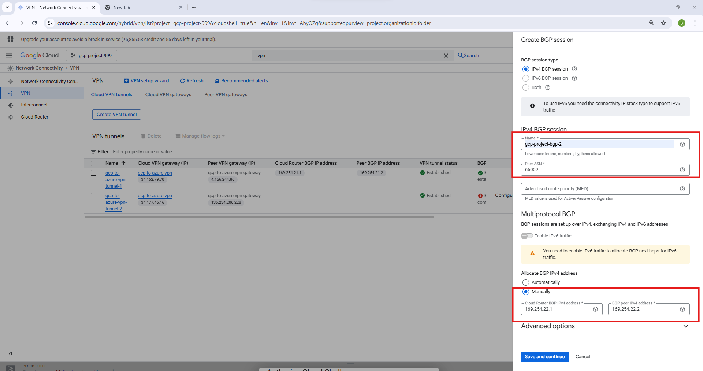

Both tunnels should now show **Established** with **BGP established**:


---

## Step 12: Validate

1. **Tunnel and BGP state**: in GCP, both tunnels show *Established* and both BGP sessions show *BGP established* (see the last screenshot above). In Azure, both connections should show *Connected*.
2. **Ping across the VPN** from `gcp-vm` to `azure-vm`'s **private IP**:

```bash
ping 192.168.0.4
```

```
64 bytes from 192.168.0.4: icmp_seq=1 ttl=63 time=16.3 ms
64 bytes from 192.168.0.4: icmp_seq=2 ttl=63 time=14.9 ms
64 bytes from 192.168.0.4: icmp_seq=3 ttl=63 time=15.1 ms
--- 192.168.0.4 ping statistics ---
3 packets transmitted, 3 received, 0% packet loss
rtt min/avg/max/mdev = 14.893/15.435/16.291/0.612 ms
```


3. Repeat from the other side: `ping 10.10.0.2` from `azure-vm`.

4. **Test the HA behaviour (optional):** start a continuous ping, then delete or disable one tunnel. BGP withdraws the routes learned over that tunnel and traffic keeps flowing over the other one, with a brief blip.

**The VPN is up.** Round-trip time of about 15 ms is expected, since both regions are in the US East.

---

## Troubleshooting

| Symptom | Likely cause |
|---|---|
| Tunnel stuck on *First handshake* / *Waiting* | PSK mismatch, wrong peer IP, or IKE version mismatch (use IKEv2 on both sides). |
| Tunnel is up but BGP is *not established* | ASN mismatch, wrong BGP peer IP, or APIPA outside `169.254.21.0`–`169.254.22.255`. Check the LNG BGP peer IP matches the Cloud Router IP, and the GCP peer IP matches the Azure APIPA IP. |
| BGP is up but ping fails | Firewall rules (GCP firewall, Azure NSG) are not allowing ICMP. Also check there is no overlap between `10.10.0.0/20` and `192.168.0.0/16`. |
| Azure connection stays *Not connected* | "Enable BGP" is set on the connection but not on the gateway (or the other way around). |
| Gateway deployment seems stuck | Normal: VPN gateways take 30–45 minutes. |

---

## Cleanup

**VpnGw2AZ and the two public IPs are billed while they exist.** When you are done:

1. Azure: delete the resource group `gcp_azure`. This removes the VNet, VMs, gateway, LNGs, connections and public IPs.
2. GCP: delete the two VPN tunnels, the HA VPN gateway, the peer VPN gateway, the Cloud Router, `gcp-vm`, and finally the VPC `gcp-azure-vpc`.

---

## Repository layout

```
gcp-azure-ha-vpn-bgp/
├── README.md                      ← this guide
├── MEDIUM_ARTICLE.md              ← the article version of this guide
└── .snapshots/
    ├── 01-azure-resource-group/
    ├── 02-azure-vnet/
    ├── 03-azure-vm/
    ├── 04-gcp-vpc-and-vm/
    ├── 05-ping-before-vpn/
    ├── 06-azure-public-ips/
    ├── 07-gcp-ha-vpn/
    ├── 08-azure-vnet-gateway/
    ├── 09-azure-local-network-gateways/
    ├── 10-azure-connections/
    ├── 11-gcp-bgp-sessions/
    └── 12-validation/
```

## Author

**Bikram Singh**: GCP Infrastructure & DevOps Lead Engineer · [GitHub](https://github.com/bikram-singh)
